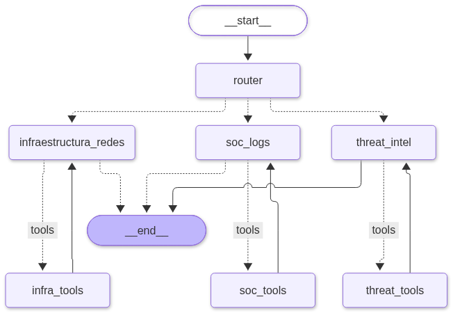

<div align="center">

# Capazeta agent

### Asistente ciberseguridad multi-agente modular basado en LangGraph y LangChain

[](https://www.python.org/)
[](LICENSE)
[]()
[](https://github.com/joaquincernik/inteligencia-artificial-final/actions/workflows/tests.yml)

</div>

---

## 📋 Tabla de contenidos

- [Demo](#-demo)
- [Sobre el proyecto](#-sobre-el-proyecto)
  - [Contexto académico](#contexto-académico)
  - [Construido con](#construido-con)
- [El dataset](#-el-dataset)
- [Metodología](#-metodología)
  - [Recorrido del trabajo por notebooks](#recorrido-del-trabajo-por-notebooks)
  - [Robustez ante fallos del LLM](#robustez-ante-fallos-del-llm-trabajo-en-master)
- [Resultados](#-resultados)
  - [Retrieval: dos fases](#evaluación-cuantitativa-del-retrieval-dos-fases)
  - [Comparación pareada (n = 88)](#comparación-pareada-n--88)
- [Estructura del proyecto](#-estructura-del-proyecto)
- [Instalación](#-instalación)
- [Integración con Wazuh (Docker)](#integración-con-wazuh-docker)
- [Uso](#-uso)
- [Tests](#-tests)
- [Roadmap](#-roadmap)
- [Autor](#-autor)
- [Licencia](#-licencia)
- [Agradecimientos y referencias](#-agradecimientos-y-referencias)

---

## 🎬 Demo



Capazeta se ejecuta de forma interactiva a través de una interfaz de línea de comandos (CLI) impulsada por `uv run capazeta`. Los recorridos cualitativos están en dos notebooks: [`notebooks/01_demo_MVP.ipynb`](notebooks/01_demo_MVP.ipynb) muestra el MVP —enrutamiento, uso de herramientas y consulta directa al RAG— y [`notebooks/05_demo_trabajo_final.ipynb`](notebooks/05_demo_trabajo_final.ipynb) repite los tres recorridos (`infraestructura_redes`, `threat_intel` y `soc_logs`) sobre la versión final, con *tools hardening* y reportes.

---

## 📖 Sobre el proyecto

**Capazeta** es un asistente de ciberseguridad multi-agente modular desarrollado con **LangGraph** y **LangChain**. Su propósito es ayudar a equipos de seguridad, administradores de red y analistas de SOC a realizar tareas de diagnóstico, análisis de vulnerabilidades, investigación de amenazas e interpretación de logs en tiempo real.

El sistema organiza sus capacidades en 3 nodos de subagentes especializados, coordinados por un enrutador principal:

1. **Infraestructura y Redes:** Análisis de topología de red, segmentación, firewalls y escaneo con Nmap.
2. **SOC / Logs y Eventos:** Análisis de SIEM, triaje de incidentes e integración con alertas de Wazuh.
3. **Threat Intelligence:** Mapeo de TTPs en MITRE ATT&CK mediante RAG (FAISS) e investigación de IOCs/CVEs.

Las verticales de **Aplicaciones Web y APIs**, **Mobile** y **OT/ICS** quedan fuera de esta iteración: están comentadas en el grafo a la espera de contar con herramientas propias. La decisión de acotar el alcance y las mejoras del MVP quedan registradas en [`notebooks/04_implementacion_roadmap.ipynb`](notebooks/04_implementacion_roadmap.ipynb).

### Contexto académico

- **Asignatura:** Inteligencia Artificial
- **Institución:** Instituto Universitario Aeronáutico
- **Cohorte / año:** 2026
- **Docente:** Alexis Gonzalez

### Construido con

- [Python 3.10+](https://www.python.org/)
- [LangChain](https://www.langchain.com/) / [LangGraph](https://python.langchain.com/docs/langgraph/)
- [FAISS](https://github.com/facebookresearch/faiss) — Almacenamiento vectorial para RAG
- [Wazuh API & Indexer](https://wazuh.com/) — Integración con SIEM y gestión de alertas
- [python-nmap](https://xael.org/pages/python-nmap-en.html) — Automatización de escaneos de red
- [Rich](https://rich.readthedocs.io/) — Interfaz de terminal (paneles, spinner y Markdown)
- [LangSmith](https://smith.langchain.com/) — Trazabilidad, monitoreo y evaluación de las ejecuciones
- [ReportLab](https://www.reportlab.com/) — Renderizado de reportes PDF
- [Docker](https://www.docker.com/) — Stack local de Wazuh (manager, indexer y dashboard)
- [uv](https://docs.astral.sh/uv/) — Gestión rápida de entornos y dependencias

---

## 📊 El dataset

Capazeta utiliza la base de conocimiento oficial **MITRE ATT&CK Enterprise** para alimentar su módulo RAG (*Retrieval-Augmented Generation*).

| Campo | Detalle |
|---|---|
| Fuente | [MITRE ATT&CK Enterprise STIX Bundle](https://github.com/mitre-attack/attack-stix-data) |
| Formato | JSON / STIX 2.1 |
| Vector Index | FAISS (Índice vectorial generado con embeddings de Gemini o Cloudflare Workers AI) |
| Variables / Campos | IDs de técnicas, tácticas, descripciones, mitigaciones y referencias de TTPs |
| Licencia del dataset | Apache 2.0 (MITRE ATT&CK) |

### Datasets de evaluación

La evaluación del retrieval se realizó en dos fases sobre alertas reales de Wazuh anotadas con técnicas MITRE ATT&CK:

| Conjunto | Alertas | Descripciones | Técnicas MITRE | Archivo |
|---|---:|---|---:|---|
| Inicial (fase 1) | 31 | 25 reglas únicas | 17 | [`tests/dataset_evaluacion_langsmith.csv`](tests/dataset_evaluacion_langsmith.csv) |
| Ampliado (fase 2) | 88 | 88 descripciones únicas | 36 | [`tests/dataset_evaluacion_langsmith_ampliado.csv`](tests/dataset_evaluacion_langsmith_ampliado.csv) |

El conjunto ampliado se construyó para reducir la fragilidad estadística del inicial. La generación de las alertas, su exportación desde Wazuh y la clasificación por `mitre_id` se detallan en [Dataset ampliado: generación y clasificación de alertas](#dataset-ampliado-generación-y-clasificación-de-alertas) y en [`notebooks/08_evaluacion_rag_dataset_ampliado.ipynb`](notebooks/08_evaluacion_rag_dataset_ampliado.ipynb).

Para la evaluación del **enrutamiento** se construyó un dataset separado y balanceado: 30 consultas en lenguaje natural, 10 por cada dominio activo (`infraestructura_redes`, `soc_logs`, `threat_intel`), sin nombrar la clase esperada en el enunciado. Está en [`tests/dataset_evaluacion_routing.csv`](tests/dataset_evaluacion_routing.csv) y se subió a LangSmith como `Evaluacion_Routing_Capazeta`; no se reutilizó el dataset `routing` previo porque contenía dominios hoy desactivados (`web_apis`, `mobile`).

---

## 🔬 Metodología

### Recorrido del trabajo por notebooks

El trabajo se desarrolló en once notebooks encadenados. Esta tabla permite seguir el recorrido completo y encontrar en qué sección del README se reporta cada resultado:

| Etapa | Notebook | Aporte | Resultado en este README |
| :--- | :--- | :--- | :--- |
| 00 · Puesta en marcha | [`00_init_proyecto.ipynb`](notebooks/00_init_proyecto.ipynb) | Clonado, entorno con `uv`, `.env`, primer arranque y stack Wazuh | [Instalación](#-instalación) |
| 01 · Demo del MVP | [`01_demo_MVP.ipynb`](notebooks/01_demo_MVP.ipynb) | Enrutamiento, tools y RAG en la versión inicial | [Demo](#-demo) |
| 02 · Evaluación del RAG | [`02_evaluacion_rag.ipynb`](notebooks/02_evaluacion_rag.ipynb) | Ground truth de 31 alertas y evaluación con LangSmith | [Fase 1](#fase-1--dataset-inicial-n--31) |
| 03 · Embeddings alternativos | [`03_evaluacion_modelos_embedding.ipynb`](notebooks/03_evaluacion_modelos_embedding.ipynb) | Qwen3, BGE y TF-IDF; intervalos y prueba pareada | [Fase 1](#fase-1--dataset-inicial-n--31) |
| 04 · Alcance del trabajo final | [`04_implementacion_roadmap.ipynb`](notebooks/04_implementacion_roadmap.ipynb) | Decisión de acotar verticales y mejoras del MVP | [Sobre el proyecto](#-sobre-el-proyecto) |
| 05 · Demo final | [`05_demo_trabajo_final.ipynb`](notebooks/05_demo_trabajo_final.ipynb) | Tools hardening, reportes y RAG en las tres verticales | [Demo](#-demo) |
| 06 · Mejoras y CI | [`06_mejoras_trabajo_final.ipynb`](notebooks/06_mejoras_trabajo_final.ipynb) | Tests, GitHub Actions, técnicas vigentes y TF-IDF | [Tests](#-tests) |
| 07 · Generación LLM | [`07_evaluacion_llm.ipynb`](notebooks/07_evaluacion_llm.ipynb) | Fidelidad, relevancia, juez independiente y acierto de técnica | [Evaluación de generación LLM](#evaluación-de-generación-llm-fidelidad-y-relevancia) |
| 08 · Dataset ampliado | [`08_evaluacion_rag_dataset_ampliado.ipynb`](notebooks/08_evaluacion_rag_dataset_ampliado.ipynb) | Generación de eventos, export y evaluación de 88 alertas | [Fase 2](#fase-2--dataset-ampliado-n--88) |
| 09 · Reintento del LLM | [`09_retry_fallo_conexion_llm.ipynb`](notebooks/09_retry_fallo_conexion_llm.ipynb) | Demo documentada del manejo de fallos de conexión | [Robustez ante fallos del LLM](#robustez-ante-fallos-del-llm-trabajo-en-master) |
| 10 · Evaluación del router | [`10_evaluacion_routing.ipynb`](notebooks/10_evaluacion_routing.ipynb) | 30 prompts, IC de Wilson y McNemar | [Evaluación cuantitativa del enrutamiento](#evaluación-cuantitativa-del-enrutamiento) |

Los notebooks 01 y 05 son demos cualitativas; el 04 registra por qué se descartaron las verticales sin herramientas propias. El 09 se trata por separado porque el código que documenta pertenece a otra línea de trabajo, como se explica más abajo.

### Arquitectura Multi-Agente

Capazeta implementa un grafo direccionado de estados (`StateGraph`) respaldado por persistencia en memoria (`InMemorySaver`):

- **Router Central:** Clasifica el requerimiento del usuario y delega la tarea al subagente de dominio correspondiente.
- **Herramientas (ToolNodes):** Subagentes con capacidad de ejecución de herramientas iterativas (`infraestructura_redes`, `soc_logs`, `threat_intel`), utilizando bucles de Tool Calling para invocar escaneos Nmap, consultas al Indexer/API de Wazuh y búsquedas vectoriales sobre MITRE ATT&CK.


### Definición PEAS del agente

Para formalizar el comportamiento del sistema, se define Capazeta bajo el marco PEAS (Russell & Norvig):

| Elemento | Definición | Aplicación en Capazeta |
| :-- | :-- | :-- |
| **P - *Performance Measure* (Medida de rendimiento)** | Criterios para evaluar si el agente actúa correctamente. | Enrutamiento correcto al subagente, mapeo preciso a técnicas/tácticas MITRE ATT&CK, respuestas fundamentadas en el contexto recuperado, análisis de respuestas no fundamentadas y utilidad de los reportes generados. |
| **E - *Environment* (Entorno)** | Espacio con el que interactúa el agente. | Consultas del usuario, stack de Wazuh (API/Indexer), objetivo de red para escaneo con Nmap, base de conocimiento MITRE ATT&CK, sistema de archivos local y herramientas disponibles. |
| **A - *Actuators* (Actuadores)** | Acciones que puede ejecutar del agente. | Respuestas al usuario, llamadas a herramientas (`run_nmap_scan`, `wazuh_list_agents`, `wazuh_search_alerts`, `wazuh_mitre_coverage`, `search_mitre_attack`), razonamiento entre subagentes y generación/guardado de reportes en Markdown y PDF. |
| **S - *Sensors* (Sensores)** | Percepciones que recibe del agente. | Mensajes del usuario, resultados de las herramientas ejecutadas, información recuperada del índice FAISS de MITRE ATT&CK, alertas/eventos de Wazuh, resultados de escaneo Nmap y estado del grafo (`AgentState`). |

### Sistema RAG (MITRE ATT&CK)

Las consultas sobre inteligencias de amenazas y cobertura de eventos se resuelven mediante búsqueda semántica contra un índice vectorial FAISS (`data/mitre/faiss`). Las técnicas y tácticas se parsean y sincronizan localmente desde el bundle de STIX.

Por defecto se usan embeddings de Gemini (`models/gemini-embedding-001`). También se puede usar Cloudflare Workers AI: configurá `CLOUDFLARE_ACCOUNT_ID`, `CLOUDFLARE_API_TOKEN` y un `EMBEDDING_MODEL` con prefijo `@cf/` (por ejemplo `@cf/qwen/qwen3-embedding-0.6b`), y reconstruí el índice con `uv run python -m capazeta.rag.build`. El índice debe regenerarse porque cambia la dimensión de los vectores.

**Técnicas vigentes:** tanto el índice FAISS como el baseline TF-IDF se construyen solo con técnicas **no deprecadas ni revocadas** de MITRE ATT&CK. El filtrado se hace con [`filter_mitre_techniques.py`](filter_mitre_techniques.py), que genera [`data/mitre/techniques_vigentes.json`](data/mitre/techniques_vigentes.json) (706 técnicas de 867). Así se excluyen IDs retirados como `T1062` (Hypervisor), `T1108` (Redundant Access) y `T1131` (Authentication Package). El detalle del procedimiento está en [`notebooks/06_mejoras_trabajo_final.ipynb`](notebooks/06_mejoras_trabajo_final.ipynb).

### Reproducibilidad

Las llamadas al LLM usan `temperature=0.0` y una semilla fija (`LLM_SEED=42`) para reducir la variabilidad entre ejecuciones. Ambos valores se pueden sobrescribir desde el `.env` con `LLM_TEMPERATURE` y `LLM_SEED`. La semilla se aplica en los proveedores que la exponen de forma nativa (Google Gemini y OpenAI) y se pasa como parámetro del modelo en Groq. El retrieval con FAISS y el baseline TF-IDF son deterministas. Aun así, las evaluaciones se reportan como una sola corrida sin repeticiones: la temperatura y la semilla reducen el ruido, pero no permiten separar la variabilidad del proveedor de la del dataset.

### Robustez ante fallos del LLM (trabajo en `master`)

El notebook [`notebooks/09_retry_fallo_conexion_llm.ipynb`](notebooks/09_retry_fallo_conexion_llm.ipynb) documenta una mejora surgida de una pregunta del docente durante la exposición: qué hacer si falla la conexión con el modelo. La estrategia es reintentar hasta **3 veces con backoff exponencial** ante errores de red, timeout o del proveedor, y si el error persiste mostrar un mensaje claro en la CLI en lugar de un traceback. La clave de API se valida al arrancar, sin imprimirla, y el notebook incluye dos casos ejecutados: una clave inválida (401, sin consumo de tokens) y una cuenta sin créditos (429).

**Alcance y honestidad:** esta implementación pertenece a la línea de trabajo de `master` (commits `54100f1`, `7cf4c61` y `016604b`). El notebook quedó incorporado a esta entrega, pero los objetos que documenta —`invoke_with_retry()`, `LLMConnectionError` y `tests/test_llm_retry.py`— **no están presentes en esta rama**: acá no hay código de reintento ni ese archivo de tests. Por eso se reporta como trabajo realizado en otra línea, no como funcionalidad verificada en el estado actual del repositorio. El traslado a esta rama queda como [ítem pendiente del roadmap](#-roadmap).

### Ground truth de la evaluación RAG

El conjunto de evaluación **inicial** tiene **31 alertas de Wazuh** (descripciones de alerta) provenientes de **25 reglas únicas**; una misma regla puede aparecer en varias filas cuando Wazuh emite descripciones distintas (por ejemplo, la regla 80791 aparece con cuatro rutas borradas). La anotación completa está en [`tests/wazuh_ground_truth_annoted.csv`](tests/wazuh_ground_truth_annoted.csv) y el subconjunto que consume LangSmith, en [`tests/dataset_evaluacion_langsmith.csv`](tests/dataset_evaluacion_langsmith.csv). El procedimiento de clasificación y evaluación está implementado en [`notebooks/02_evaluacion_rag.ipynb`](notebooks/02_evaluacion_rag.ipynb). El conjunto ampliado se describe más abajo.

- **Fuente de la técnica:** el `mitre_id` de referencia se tomó del **mapeo MITRE ATT&CK que declaran las propias reglas de Wazuh** (`rule.id` → `mitre.id`), no de una comparación manual contra el catálogo.
- **Unidad de anotación:** cada fila corresponde a una descripción de alerta (`rule.description`), que es exactamente el texto que se usa como consulta al retriever. La columna `Count` registra cuántos eventos de esa descripción se observaron y **no** se usa para ponderar la métrica.
- **Casos sin mapeo explícito:** cuando la regla no traía una técnica declarada, se infirió a partir del recurso auditado y de reglas relacionadas, y se marcó en `notes` como `Inferido`. Es el caso de la regla 80783 (`Audit: Watch - Read access.`), mapeada a T1003.008 por el watch de lectura sobre `/etc/shadow`.
- **Notas de anotación:** `notes` documenta ambigüedades y advertencias. Las cinco filas con nota son:

| Regla | Alerta | Nota textual |
| :--- | :--- | :--- |
| 80783 | Audit: Watch - Read access. | `Inferido: watch de lectura (audit-wazuh-r) sobre /etc/shadow` |
| 554 | File added to the system. | `Mapeo según Wazuh; tambien aplica T1565.001` |
| 80781 | Audit: Watch - Write access: /etc/passwd. | `Tambien podria ser T1098` |
| 521 | Possible kernel level rootkit | `Probable falso positivo en este entorno` |
| 5301 | User missed the password to change UID (user id). | `Fallo de su` |

- **Reglas con más de una técnica válida:** el dataset de evaluación guarda **una sola técnica de referencia por alerta** (el mapeo principal de Wazuh). Las alternativas quedan documentadas en `notes`, pero el evaluador actual (`mitre_retrieval_evaluator`, en los notebooks 02 y 03) solo compara contra ese `mitre_id` principal. Por lo tanto, si el retriever devuelve una alternativa válida en lugar de la principal, la fila se cuenta como *miss*. Es un criterio **conservador**: Hit@5 y MRR funcionan como piso, no como techo.

### Dataset ampliado: generación y clasificación de alertas

Para superar la fragilidad estadística del conjunto inicial se amplió la evaluación a **88 alertas** (88 descripciones únicas, **36 técnicas MITRE distintas**). El procedimiento está documentado en [`notebooks/08_evaluacion_rag_dataset_ampliado.ipynb`](notebooks/08_evaluacion_rag_dataset_ampliado.ipynb) y consta de tres etapas:

1. **Generación de eventos benignos en el stack de Wazuh.** El script [`tests/wazuh_generar_eventos_v2.sh`](tests/wazuh_generar_eventos_v2.sh) (requiere `sudo`) ejecuta comandos reales de *discovery*, credential access, creación de cuentas, persistencia (cron/systemd), escalada de privilegios, FIM, ofuscación, simulación web y transferencia/C2. Cada técnica se marca en syslog con `logger "WAZUH_SIM: INICIANDO <TID> - <nombre>"` y hay una pausa de 3 s entre técnicas para que Wazuh alcance a emitir las alertas. El script usa un sufijo aleatorio para usuarios y archivos temporales, y revierte todo lo que crea.
2. **Exportación de alertas desde Wazuh.** Se exportan desde el dashboard de Wazuh las alertas correspondientes a la generación (los marcadores `WAZUH_SIM:` permiten identificar la sesión de prueba).
3. **Clasificación por `mitre_id`.** Cada descripción de alerta se etiqueta con su técnica MITRE guiándose por el mapeo que declara la propia regla de Wazuh (`rule.id` → `mitre.id`) y, para los casos sin mapeo explícito, por la sección *Data Sources* del portal oficial de MITRE ATT&CK. El resultado es [`tests/dataset_evaluacion_langsmith_ampliado.csv`](tests/dataset_evaluacion_langsmith_ampliado.csv), con las columnas `rule.description` y `mitre_id`.

A diferencia del conjunto inicial, el ampliado no registra notas por fila, así que se mantiene el criterio de **una técnica de referencia por alerta** y el evaluador sigue siendo conservador (una alternativa válida cuenta como *miss*). Las alertas se subieron a LangSmith bajo el dataset `Evaluacion_Wazuh_MITRE_DATASET_AMPLIADO` y se evaluaron contra TF-IDF y los tres modelos de embeddings.

---

## 📈 Resultados

Todas las evaluaciones del proyecto, con su muestra y su resultado principal:

| Evaluación | Qué mide | Muestra | Resultado principal | Detalle |
| :--- | :--- | :---: | :--- | :--- |
| **Enrutamiento** | Clase elegida por el `router` | 30 prompts (10 por dominio) | Gemini 96,7 % vs. Groq 93,3 %; McNemar `p = 1,0` | [Evaluación cuantitativa del enrutamiento](#evaluación-cuantitativa-del-enrutamiento) |
| **Retrieval · fase 1** | Hit@5 y MRR sobre alertas de Wazuh | 31 alertas / 17 técnicas | Gemini 67,74 % de Hit@5 | [Fase 1](#fase-1--dataset-inicial-n--31) |
| **Retrieval · fase 2** | Hit@5 y MRR con dataset ampliado | 88 alertas / 36 técnicas | Gemini 67,05 % de Hit@5, IC [57,22 %, 76,87 %] | [Fase 2](#fase-2--dataset-ampliado-n--88) |
| **Generación LLM** | Fidelidad, relevancia y acierto de técnica | 31 respuestas | 4,26/5 y 4,77/5; acierto 64,5 % | [Evaluación de generación LLM](#evaluación-de-generación-llm-fidelidad-y-relevancia) |
| **Tests automáticos** | Allowlist de Nmap y reportes PDF | suite `pytest` | 50 passed, 1 skipped (test de red) | [Tests](#-tests) |

### Estado actual

El sistema está implementado y validado de punta a punta: resuelve consultas de ciberseguridad con enrutamiento multi-agente, ejecuta herramientas reales, recupera técnicas MITRE mediante RAG y genera reportes. La validación combina pruebas cualitativas de las funcionalidades con evaluación cuantitativa de las tres decisiones críticas —**enrutamiento**, *retrieval* y generación LLM—, además de una suite automática de tests.

- **Enrutamiento multi-agente:** Clasificación correcta de las consultas hacia los 3 dominios de especialidad activos, medida cuantitativamente sobre 30 prompts en [`notebooks/10_evaluacion_routing.ipynb`](notebooks/10_evaluacion_routing.ipynb). Ver [Evaluación cuantitativa del enrutamiento](#evaluación-cuantitativa-del-enrutamiento).
- **Herramientas activas:** Escaneo de red con Nmap (destino, puertos y flags validados contra una lista blanca), consulta de agentes/eventos/alertas desde Wazuh API/Indexer y generación automatizada de reportes en Markdown y PDF. La demostración de estos tres recorridos está en [`notebooks/05_demo_trabajo_final.ipynb`](notebooks/05_demo_trabajo_final.ipynb).
- **RAG MITRE ATT&CK:** Recuperación semántica de técnicas y tácticas desde el bundle STIX sobre un índice vectorial FAISS, con embeddings de Gemini (por defecto) o Cloudflare Workers AI.
- **Evaluación ampliada:** el dataset de retrieval pasó de 31 a 88 alertas (17 → 36 técnicas); Gemini mantuvo su Hit@5 en ~67 % y el margen de error cayó de ±16.45 a ±9.82 pp. Ver [Resultados](#-resultados).
- **Evaluación de generación LLM:** fidelidad y relevancia anotadas en LangSmith sobre 31 respuestas, contrastadas con un juez independiente, más el acierto de la técnica principal. Ver [Evaluación de generación LLM](#evaluación-de-generación-llm-fidelidad-y-relevancia).
- **Tests automáticos:** suite de `pytest` sobre la allowlist de Nmap y la generación de PDFs (50 pasan, 1 se omite por requerir red real). Ver [Tests](#-tests).
- **Arquitectura modular:** Grafo LangGraph con bucles de tool-calling y persistencia en memoria (`InMemorySaver`).

### Evaluación cuantitativa del retrieval: dos fases

La evaluación se realizó en dos fases con el mismo protocolo: cada sistema devuelve el Top 5 de técnicas MITRE para cada descripción de alerta. Las métricas se registraron con **LangSmith**:

- **Hit@5:** proporción de consultas en las que la técnica de referencia (el `mitre_id` principal anotado) aparece entre los 5 primeros resultados. Las técnicas alternativas documentadas en `notes` no se acreditan.
- **MRR (*Mean Reciprocal Rank*):** promedio del inverso de la posición de la técnica de referencia en el ranking (0 si no aparece).
- **Latencia promedio:** tiempo medio de respuesta del retrieval por consulta.

Cada modelo se evaluó en **una sola corrida**, sin repeticiones, y el IC del 95 % se calcula con la aproximación normal (Wald): `p ± 1.96·sqrt(p(1−p)/n)`, donde `p` es el Hit@5 observado y `n` el tamaño de la muestra.

#### Fase 1 — dataset inicial (n = 31)

Se evaluó sobre **31 alertas reales de Wazuh** (25 reglas únicas, 17 técnicas MITRE) mapeadas a MITRE ATT&CK a partir de las propias reglas de Wazuh. El dataset está en [`tests/dataset_evaluacion_langsmith.csv`](tests/dataset_evaluacion_langsmith.csv) y la anotación completa (con regla, técnica, táctica y notas) en [`tests/wazuh_ground_truth_annoted.csv`](tests/wazuh_ground_truth_annoted.csv). El criterio de anotación se detalla en [Ground truth de la evaluación RAG](#ground-truth-de-la-evaluación-rag). El análisis por modelo está en [`notebooks/02_evaluacion_rag.ipynb`](notebooks/02_evaluacion_rag.ipynb) y [`notebooks/03_evaluacion_modelos_embedding.ipynb`](notebooks/03_evaluacion_modelos_embedding.ipynb).

| Modelo / Sistema | Tipo / Proveedor | Muestras | Hit@5 | IC 95 % (Hit@5) | MRR | Latencia prom. |
| :--- | :--- | :---: | :---: | :---: | :---: | :---: |
| **Gemini embedding-001** | Semántico / Google Cloud | 31 | **67.74 %** | **[51.29 %, 84.20 %]** | **0.4866** | 636.4 ms |
| **Qwen3 embedding-0.6b** | Semántico / Cloudflare Workers AI | 31 | **54.84 %** | [37.32 %, 72.36 %] | **0.3989** | 2012.0 ms |
| **BGE-Large-EN-v1.5** | Semántico / Cloudflare Workers AI | 31 | **51.61 %** | [34.02 %, 69.20 %] | **0.3505** | 651.7 ms |
| **Baseline (TF-IDF)** | Léxico tradicional / algorítmico | 31 | **32.26 %** | [15.80 %, 48.71 %] | **0.2258** | **2.6 ms** |


**Intervalos de confianza y alcance del experimento:** cada modelo se evaluó en **una sola corrida**, sin repeticiones. El dataset tiene **31 alertas que cubren 17 técnicas MITRE distintas** (25 reglas únicas), por lo que los números son frágiles. El IC del 95 % se calculó con la aproximación normal (Wald): `p ± 1.96·sqrt(p(1−p)/n)`, donde `p` es el Hit@5 observado y `n` = 31 alertas para todos los modelos reportados. Por eso el IC de Gemini va de **51.29 % a 84.20 %** (redondeado, 52 %–84 %) y se superpone con los de Qwen3 y BGE: en esta fase la ventaja observada es **indicativa**, no concluyente. **Plamo embedding-1b se excluyó de la comparación** porque solo procesó 14 de las 31 alertas; sus resultados no son comparables con los demás. La comparación pareada por alerta —más adecuada que los intervalos marginales cuando el ground truth está desbalanceado— se reporta en [Fase 2](#fase-2--dataset-ampliado-n--88), sobre las 88 alertas.

**Lectura de los resultados:** el mejor modelo semántico (Gemini embedding-001) mejora el baseline léxico TF-IDF en **+35.48 puntos porcentuales de Hit@5** y más que duplica el MRR (0.4866 vs. 0.2258). El costo es la latencia: 636.4 ms frente a 2.6 ms del baseline. La diferencia contra TF-IDF es la más clara (los intervalos no se solapan), mientras que entre los modelos semánticos el orden debe tomarse como tendencia.

**Limitaciones de la anotación:** al ser un ground truth de etiqueta única, los valores de la tabla son conservadores. En las dos filas con técnica alternativa (554 → T1565.001; 80781 → T1098), las corridas registradas no devolvieron esas alternativas en el Top 5, así que los números no cambian; si en el futuro se aceptaran, el Hit@5 solo podría subir. Además, una de las 31 filas (80783) usa una técnica inferida: un cambio en esa anotación movería el Hit@5 como máximo 3.2 puntos porcentuales (1/31) y el MRR hasta 0.032, y el efecto exacto depende del modelo.

Los resultados completos, con el análisis por modelo, están en [`notebooks/02_evaluacion_rag.ipynb`](notebooks/02_evaluacion_rag.ipynb) y [`notebooks/03_evaluacion_modelos_embedding.ipynb`](notebooks/03_evaluacion_modelos_embedding.ipynb); las salidas crudas de LangSmith, en [`reports/`](reports/).

#### Fase 2 — dataset ampliado (n = 88)

Para reducir la fragilidad estadística de la fase 1 se amplió el ground truth a **88 alertas** (88 descripciones únicas, **36 técnicas MITRE distintas**); el procedimiento de generación y clasificación está en [Dataset ampliado: generación y clasificación de alertas](#dataset-ampliado-generación-y-clasificación-de-alertas). El protocolo, las métricas y el criterio de anotación de etiqueta única son los mismos que en la fase 1. Los resultados, verificados directamente desde los CSVs de `reports/`, son:

| Modelo / Sistema | Tipo / Proveedor | Muestras | Hit@5 | IC 95 % (Hit@5) | MRR | Latencia prom. |
| :--- | :--- | :---: | :---: | :---: | :---: | :---: |
| **Gemini embedding-001** | Semántico / Google Cloud | 88 | **67.05 %** | **[57.22 %, 76.87 %]** | **0.4657** | 529.8 ms |
| **Qwen3 embedding-0.6b** | Semántico / Cloudflare Workers AI | 88 | **50.00 %** | [39.55 %, 60.45 %] | **0.3439** | 1267.9 ms |
| **BGE-Large-EN-v1.5** | Semántico / Cloudflare Workers AI | 88 | **42.05 %** | [31.73 %, 52.36 %] | **0.2862** | 627.6 ms |
| **Baseline (TF-IDF)** | Léxico tradicional / algorítmico | 88 | **28.41 %** | [18.99 %, 37.83 %] | **0.1544** | **2.7 ms** |

**Lectura de los resultados:** el hallazgo central es que Gemini **mantuvo su rendimiento** al casi triplicar la muestra: 67.74 % → 67.05 % (**−0.7 pp**). En cambio, los baseline cayeron (TF-IDF −3.85 pp, BGE −9.56 pp, Qwen3 −4.84 pp), lo que confirma que el buen resultado inicial de Gemini no era un artefacto de la muestra pequeña. Gemini supera al baseline léxico por **+38.64 pp de Hit@5** y más que triplica el MRR (0.4657 vs. 0.1544), con una latencia de 529.8 ms frente a 2.7 ms de TF-IDF (aceptable en un flujo de triaje asíncrono del SOC).

**Intervalos de confianza:** al pasar de n = 31 a n = 88, el margen de error de Gemini se redujo de **±16.45 pp a ±9.82 pp**. Su IC 95 % **[57.22 %, 76.87 %] no se solapa** con el de TF-IDF [18.99 %, 37.83 %] ni con el de BGE [31.73 %, 52.36 %], así que la ventaja sobre esos dos sistemas ahora es **concluyente** (en la fase 1 solo era indicativa). Sí se solapa con Qwen3 [39.55 %, 60.45 %], pero ese intervalo marginal no tiene en cuenta que es **la misma alerta** la que se compara en ambos sistemas: la [comparación pareada](#comparación-pareada-n--88) de más abajo detecta una diferencia significativa. **Plamo embedding-1b** vuelve a quedar fuera: en la fase 1 solo procesó 14 de 31 alertas y en esta fase no se repitió su evaluación.

La anotación del conjunto ampliado no incluye notas por fila, así que se mantiene el criterio conservador de una sola técnica de referencia por alerta. El análisis completo está en [`notebooks/08_evaluacion_rag_dataset_ampliado.ipynb`](notebooks/08_evaluacion_rag_dataset_ampliado.ipynb); el ground truth en [`tests/dataset_evaluacion_langsmith_ampliado.csv`](tests/dataset_evaluacion_langsmith_ampliado.csv) y las salidas crudas de LangSmith en [`reports/evaluacion_capazeta_rag_ampliado_gemini-embedding-001.csv`](reports/evaluacion_capazeta_rag_ampliado_gemini-embedding-001.csv), [`reports/evaluacion_dataset_ampliado_capazeta_rag_qwen3-embedding-0.6b.csv`](reports/evaluacion_dataset_ampliado_capazeta_rag_qwen3-embedding-0.6b.csv), [`reports/evaluacion_dataset_ampliado_capazeta_rag_bge-large-en-v1.5.csv`](reports/evaluacion_dataset_ampliado_capazeta_rag_bge-large-en-v1.5.csv) y [`reports/evaluacion_capazeta_ampliado_tf_idf.csv`](reports/evaluacion_capazeta_ampliado_tf_idf.csv).

##### Comparación pareada (n = 88)

Los intervalos de Wald de la tabla anterior tratan cada alerta como independiente y resumen el Hit@5 con una varianza global. Eso es problemático aquí: el ground truth ampliado tiene **36 técnicas MITRE distintas y 15 de ellas tienen una sola alerta**, de modo que la dificultad no es homogénea. Como los cuatro sistemas se evaluaron sobre **las mismas 88 alertas** (`example_id` compartido), se pueden aparear las observaciones por alerta y comparar sus diferencias: al hacerlo se cancela la dificultad inherente de cada técnica, incluidas las 15 con un solo caso.

Se usan dos pruebas complementarias según la naturaleza de la métrica:

- **McNemar exacto** sobre el **Hit@5 binario** por alerta: cuenta cuántas alertas gana un sistema (`b`) y cuántas pierde (`c`) frente al otro. Es la prueba pareada correcta para aciertos sí/no; aplicar Wilcoxon a una variable binaria no es adecuado.
- **Wilcoxon de rangos con signo** sobre el **MRR** por alerta: el MRR es una métrica continua/ordinal, así que sus diferencias apareadas sí se analizan con este test.

| Par comparado | b (gana A) | c (gana B) | p McNemar (Hit@5) | Δ MRR medio | p Wilcoxon (MRR) |
| :--- | :---: | :---: | :---: | :---: | :---: |
| Gemini embedding-001 vs Qwen3 embedding-0.6b | 20 | 5 | **0,00408** | +0,1218 | **0,00200** |
| Gemini embedding-001 vs BGE-Large-EN-v1.5 | 25 | 3 | **2,74 × 10⁻⁵** | +0,1795 | **0,000156** |
| Gemini embedding-001 vs TF-IDF | 35 | 1 | **1,08 × 10⁻⁹** | +0,3114 | **1,13 × 10⁻⁹** |
| Qwen3 embedding-0.6b vs BGE-Large-EN-v1.5 | 11 | 4 | 0,118 | +0,0578 | 0,126 |
| Qwen3 embedding-0.6b vs TF-IDF | 24 | 5 | **0,000546** | +0,1896 | **1,39 × 10⁻⁵** |
| BGE-Large-EN-v1.5 vs TF-IDF | 17 | 5 | **0,0169** | +0,1318 | **0,000168** |

**Lectura:** la ventaja de Gemini sobre Qwen3, BGE y TF-IDF es estadísticamente significativa en las dos métricas (p < 0,01), incluso contra Qwen3, cuyos intervalos de Wald se solapaban. Qwen3 vs BGE no muestra evidencia de diferencia (p ≈ 0,12 en ambos tests): su orden no puede afirmarse con estos datos. El resto de los pares, incluidos los dos contra TF-IDF, también son significativos (p < 0,05). Las pruebas son bilaterales, sobre 88 pares apareados y una sola corrida por sistema; los cálculos son reproducibles desde [`reports/evaluacion_pareada_ampliado.csv`](reports/evaluacion_pareada_ampliado.csv) y desde la celda correspondiente de [`notebooks/03_evaluacion_modelos_embedding.ipynb`](notebooks/03_evaluacion_modelos_embedding.ipynb).

### Evaluación de generación LLM (fidelidad y relevancia)

La calidad de la **respuesta final** se evalúa en [`notebooks/07_evaluacion_llm.ipynb`](notebooks/07_evaluacion_llm.ipynb). El experimento reutiliza el Top-5 que ya recuperó Gemini para cada una de las 31 alertas, genera una respuesta de triaje con el LLM y registra la corrida en [LangSmith](https://www.langchain.com/langsmith). **Este experimento corresponde al dataset inicial de 31 alertas (Fase 1) y no se repitió sobre las 88 del dataset ampliado**; las cifras de abajo no deben leerse como resultados de la Fase 2. El motivo es de presupuesto: generar una respuesta por cada una de las 88 alertas y volver a puntuarlas con el juez independiente supondrían unas 176 llamadas a modelos y un volumen de tokens que **agotaría el presupuesto disponible** del proyecto. Por eso se evaluaron 31 alertas y no 88.

Se miden dos dimensiones con una rúbrica manual de 1 a 5:

- **Fidelidad (*Faithfulness*):** que todas las afirmaciones y técnicas mencionadas estén respaldadas por el contexto recuperado.
- **Relevancia de la respuesta (*Answer Relevance*):** que la respuesta esté alineada con la consulta original e incluya acciones de triaje.

La anotación se hace en una **annotation queue de LangSmith** (feedback `fidelidad` y `relevancia`, escala 1–5). Después descargás el **export CSV** desde LangSmith, lo guardás en `reports/` y [`notebooks/07_evaluacion_llm.ipynb`](notebooks/07_evaluacion_llm.ipynb) lo interpreta para calcular el resumen; la descarga es manual y el notebook no consulta la API. También queda un CSV manual como respaldo si preferís puntuar en Excel. La puntuación se complementa con chequeos automáticos objetivos (acierto de la técnica principal, IDs mencionados fuera del contexto y latencia). **Estado: anotado (31/31)**.

**Resultados en la escala original del export (1–5):** **Fidelidad** media **4.26/5** (IC 95 % [3.93, 4.59]), 25/31 respuestas con puntaje ≥ 4; **Relevancia** media **4.77/5** (IC 95 % [4.58, 4.97]), 29/31 con puntaje ≥ 4. Las versiones anteriores reportaban estos valores normalizados a 0–1 (0.815 y 0.944); la equivalencia se conserva en columnas separadas (`*_0a1`) de [`reports/evaluacion_llm_resumen.csv`](reports/evaluacion_llm_resumen.csv) para evitar confusiones con el export de LangSmith. En esta muestra acotada los resultados **sugieren** una tendencia a apoyarse en el contexto y a entregar triaje útil, pero 6 respuestas de fidelidad quedaron por debajo de 4: no respaldan afirmaciones de alucinaciones eliminadas ni de un desempeño sin matices.

**Acierto de la técnica principal (extremo a extremo).** El LLM elige correctamente la técnica de referencia en el **64,5 %** de las 31 alertas. El resultado depende por completo de la recuperación previa: cuando el RAG incluye la técnica correcta en el Top‑5 (Hit@5 = 1), el acierto asciende al **95 %**; cuando no la recupera, es **0 %**. Es la métrica más honesta de extremo a extremo porque condiciona el éxito final del LLM a la calidad del retrieval, y no solo a la búsqueda o a la generación por separado. El ground truth sigue siendo de una sola técnica por alerta, derivado del mapeo de Wazuh. El cálculo y su desagregado están en la sección 14 de [`notebooks/07_evaluacion_llm.ipynb`](notebooks/07_evaluacion_llm.ipynb).

**Doble evaluación y acuerdo.** Los puntajes principales provienen de un único anotador (el autor), así que se contrastaron con un **juez LLM independiente** (`groq:openai/gpt-oss-120b`, proveedor distinto del generador `google_genai:gemini-3.1-flash-lite`) usando la misma rúbrica; el procedimiento está en la sección 12 de [`notebooks/07_evaluacion_llm.ipynb`](notebooks/07_evaluacion_llm.ipynb). Los resultados están en [`reports/evaluacion_llm_juez_groq.csv`](reports/evaluacion_llm_juez_groq.csv) y [`reports/evaluacion_llm_acuerdo.csv`](reports/evaluacion_llm_acuerdo.csv): en fidelidad, acuerdo exacto 61.3 %, con tolerancia ±1 del 96.8 % y kappa lineal 0.595 (acuerdo moderado); en relevancia, acuerdo exacto 83.9 %, pero el juez asignó 5 a las 31 respuestas, por lo que el kappa es 0 y esa cifra no aporta evidencia de acuerdo. Un juez LLM no reemplaza a un segundo anotador humano y tiene sus propios sesgos, así que estas mediciones son **preliminares** y requieren supervisión analítica. La automatización con [**Ragas**](https://docs.ragas.io/) y un segundo anotador humano quedan como trabajo futuro en el [roadmap](#-roadmap).

**Alcance de la muestra.** El juez se aplicó sobre las mismas 31 alertas de la Fase 1 porque es el único conjunto con respuestas generadas y su contexto recuperado (`outputs.respuesta` y `outputs.contexto_texto` en el export de LangSmith). El dataset ampliado de 88 solo registra métricas de *retrieval* (Hit@5/MRR y técnicas recuperadas), sin salidas del LLM que evaluar. Generar esas 88 respuestas y someterlas además al juez implicaría unas 176 llamadas y **agotaría el presupuesto de tokens disponible**: esa es la razón práctica por la que la evaluación de generación se limitó a 31 alertas y no a 88. Extenderla a las 88 queda registrado en el [roadmap](#-roadmap).

### Evaluación cuantitativa del enrutamiento

La corrección señalaba que del agente completo solo se medían el *retrieval* y la generación sobre contexto fijo, y que el `router` quedaba fuera. El notebook [`notebooks/10_evaluacion_routing.ipynb`](notebooks/10_evaluacion_routing.ipynb) cierra ese hueco: evalúa **solo la decisión del router**, sin ejecutar tools, RAG ni generación final. Se usan las mismas 30 preguntas para ambos modelos, con `temperature=0` y semilla 42, una sola corrida y `max_concurrency=2`, registradas en LangSmith mediante `evaluate()` sobre el dataset `Evaluacion_Routing_Capazeta`.

| Router del grafo | Acierto | IC 95 % (Wilson) | F1 macro | Formato válido | Latencia mediana |
| :--- | :---: | :---: | :---: | :---: | :---: |
| **Gemini** (activo, `MODEL_1`) | **29/30 = 96,7 %** | [83,3 %, 99,4 %] | 0,967 | 30/30 (100 %) | 2,87 s |
| Groq (alternativo, `MODEL_2`) | 28/30 = 93,3 % | [78,7 %, 98,2 %] | 0,947 | 29/30 (96,7 %) | 0,54 s |

**Lectura.** Ambos routers aciertan el 100 % de `infraestructura_redes` y `soc_logs`; el único error de decisión de cada uno es la consulta sobre «generar un informe con reglas de detección para Wazuh», que clasifican como `soc_logs` en vez de `threat_intel`. Un segundo fallo de Groq fue un **429 por límite de tasa**, no una decisión de enrutamiento: con `b=1` y `c=0`, la prueba de McNemar exacta da **`p = 1,0`**, así que no hay evidencia para declarar un ganador. Descartando esa fila por error de infraestructura, ambos quedan en 28/29 (96,6 %) sobre las preguntas que decidieron. Groq sí es unas 5 veces más rápido en la mediana, mientras Gemini tuvo una cola de latencia pronunciada (un caso de 160,97 s).

El ground truth está en [`tests/dataset_evaluacion_routing.csv`](tests/dataset_evaluacion_routing.csv); los resultados completos, en [`reports/evaluacion_routing_resumen.csv`](reports/evaluacion_routing_resumen.csv), [`reports/evaluacion_routing_matriz_gemini.csv`](reports/evaluacion_routing_matriz_gemini.csv), [`reports/evaluacion_routing_matriz_groq.csv`](reports/evaluacion_routing_matriz_groq.csv), [`reports/evaluacion_routing_comparacion.csv`](reports/evaluacion_routing_comparacion.csv) y los exports crudos [`reports/evaluacion_routing_gemini_raw.csv`](reports/evaluacion_routing_gemini_raw.csv) y [`reports/evaluacion_routing_groq_raw.csv`](reports/evaluacion_routing_groq_raw.csv). Los intervalos son de Wilson porque con n = 30 la aproximación normal es poco fiable, y la comparación es pareada por pregunta.


---

## 📂 Estructura del proyecto

```text
.
├── README.md
├── LICENSE
├── pyproject.toml
├── .gitignore
├── .env.example
├── src/
│   └── capazeta/
│       ├── config.py           # Configuración de variables de entorno y parámetros
│       ├── embeddings.py       # Configuración del modelo de Embeddings
│       ├── llm.py              # Inicialización de Chat Models y reintentos de conexión
│       ├── main.py             # Bucle de interacción interactivo (CLI)
│       ├── ui.py               # Capa de presentación de la CLI (Rich)
│       ├── graph/              # Grafo de estados, nodos y constructor de LangGraph
│       │   ├── builder.py
│       │   ├── nodes.py
│       │   └── state.py
│       ├── rag/                # Construcción y lectura de índice FAISS (MITRE)
│       │   ├── build.py
│       │   └── mitre.py
│       └── tools/              # Herramientas (Nmap, Wazuh, MITRE RAG, Reportes)
│           ├── mitre_tool.py
│           ├── nmap_tool.py
│           ├── pdf_report.py
│           ├── report.py
│           └── wazuh_tool.py
├── data/
│   └── mitre/                  # Datos y catálogo de técnicas de MITRE ATT&CK
├── reports/                    # CSVs de evaluación y reportes generados (.md/.pdf)
├── notebooks/                  # Notebooks de exploración, evaluación y demos
├── tests/                      # Tests de Nmap y PDFs, datasets de evaluación y script de Wazuh
├── infra/
│   └── wazuh/                  # Stack Docker single-node de Wazuh
└── docs/
    ├── index.html              # Página estática para GitHub Pages
    ├── assets/
    │   ├── input.css           # Fuente de Tailwind (tokens y componentes)
    │   ├── tailwind.css        # CSS compilado y versionado
    │   └── app.js              # Tema claro/oscuro, scroll-spy y animaciones
    └── img/                    # Diagrama de arquitectura y capturas
        ├── grafico.png
        ├── cli.png
        └── comparativa_embeddings.png
```

El sitio de `docs/` es estático y no necesita build para publicarse en GitHub Pages: el CSS compilado (`docs/assets/tailwind.css`) queda versionado. Si modificás el HTML, regenerá los estilos con:

```bash
npm install
npm run build:css
```

---

## ⚙️ Instalación

### Prerrequisitos

- [uv](https://docs.astral.sh/uv/getting-started/installation/)
- Git
- Python >= 3.10
- [Docker](https://www.docker.com/) y [Docker Compose](https://docs.docker.com/compose/) *(solo si vas a utilizar la integración con Wazuh)*

### Pasos

```bash
# 1. Cloná el repositorio
git clone https://github.com/joaquincernik/inteligencia-artificial-final

# 2. Creá el entorno virtual e instalá las dependencias con uv
uv venv --python 3.10
source .venv/bin/activate  # En Windows: .venv\Scripts\activate

# 3. Sincronizá e instalá el proyecto en modo editable
uv sync
uv pip install -e .
```

> **Guía visual:** el notebook [`notebooks/00_init_proyecto.ipynb`](notebooks/00_init_proyecto.ipynb) recorre estos mismos pasos —clonado, entorno, variables de entorno, Wazuh con Docker y primera ejecución— con capturas de pantalla.

### Configuración de Variables de Entorno

Copiá el archivo de ejemplo y completá con tus credenciales:

```bash
cp .env.example .env
```

Las variables principales son (el listado completo y comentado está en [`.env.example`](.env.example)):

```env
GOOGLE_API_KEY=tu_api_key_aqui
OPENAI_API_KEY=tu_openai_api_key_aqui
GROQ_API_KEY=tu_groq_api_key_aqui

# Cloudflare Workers AI (para embeddings alternativos)
CLOUDFLARE_ACCOUNT_ID=tu_account_id_aqui
CLOUDFLARE_API_TOKEN=tu_api_token_aqui

# Catálogo de modelos disponibles (elegí el activo en MODEL_NAME):
MODEL_1=google_genai:gemini-3.1-flash-lite
MODEL_2=groq:openai/gpt-oss-120b
#MODEL_3=openai:gpt-4o-mini
MODEL_4=groq:openai/gpt-oss-20b
MODEL_5=groq:qwen/qwen3.8-27b
MODEL_6=groq:openai/gpt-oss-safeguard-20b

# Modelo activo (referenciá una variable definida arriba):
MODEL_NAME=${MODEL_2}

# Determinismo del LLM (temperatura 0 y semilla fija)
LLM_TEMPERATURE=0.0
LLM_SEED=42

# Configuración MITRE RAG
EMBEDDING_MODEL=models/gemini-embedding-001
MITRE_STIX_URL=https://raw.githubusercontent.com/mitre-attack/attack-stix-data/master/enterprise-attack/enterprise-attack.json
MITRE_DATA_DIR=data/mitre

# Configuración Wazuh
WAZUH_API_URL=https://localhost:55000
WAZUH_API_USER=wazuh-wui
WAZUH_API_PASSWORD=tu_password_aqui
WAZUH_INDEXER_URL=https://localhost:9200
WAZUH_INDEXER_USER=admin
WAZUH_INDEXER_PASSWORD=tu_password_aqui
WAZUH_VERIFY_SSL=false

# LangSmith (trazabilidad)
LANGSMITH_TRACING=true
LANGSMITH_ENDPOINT=https://api.smith.langchain.com
LANGSMITH_API_KEY=tu_langsmith_api_key_aqui
LANGSMITH_PROJECT=IA
``` 

### Trazabilidad con LangSmith

Capazeta puede enviar cada ejecución del grafo a [LangSmith](https://smith.langchain.com/) para inspeccionar el recorrido del router, las llamadas a tools (Nmap, Wazuh, RAG MITRE) y el consumo de tokens.

1. Creá una cuenta en [smith.langchain.com](https://smith.langchain.com/) y generá una API key (`Settings → API Keys`).
2. Completá las variables en tu `.env`:

```env
LANGSMITH_TRACING=true
LANGSMITH_ENDPOINT=https://api.smith.langchain.com
LANGSMITH_API_KEY=tu_langsmith_api_key_aqui
LANGSMITH_PROJECT=IA
```

3. Ejecutá `uv run capazeta` como siempre. Las trazas aparecen en el proyecto **IA**.

En el dashboard, cada consulta se registra como un run llamado `capazeta`, etiquetado con `model:<id>` (por ejemplo `model:gpt-oss-120b`) y con la metadata `model` y `thread_id`, lo que permite filtrar las ejecuciones por modelo o por sesión.

Para desactivar el tracing alcanza con `LANGSMITH_TRACING=false`; no hay que tocar código.

---

## Integración con Wazuh (Docker)

Capazeta cuenta con herramientas para consultar agentes, alertas y realizar mapeo a MITRE ATT&CK utilizando un stack de Wazuh. Para levantarlo localmente podés utilizar la configuración incluida en `infra/wazuh/`.

### Requisitos
- Docker y Docker Compose
- Mínimo 4GB de RAM libres (recomendado)
- Sistema Linux, macOS o Windows con WSL2

### Pasos para levantar el stack

```bash
# 1. Ir al directorio de Wazuh (single-node)
cd infra/wazuh

# 2. Aumentar vm.max_map_count (obligatorio en Linux)
sudo sysctl -w vm.max_map_count=262144

# 3. Generar los certificados TLS (solo la primera vez)
docker compose -f generate-indexer-certs.yml run --rm generator

# 4. Levantar el stack en segundo plano
docker compose up -d
```

### Acceso

| Servicio | URL / Puerto | Credenciales por defecto |
| :-- | :-- | :-- |
| Wazuh Dashboard | `https://localhost` | Configuradas en el stack (revisar `docker-compose.yml` / `config/`) |
| Wazuh API | `https://localhost:55000` | Coinciden con las variables `WAZUH_API_*` |
| Wazuh Indexer (OpenSearch) | `https://localhost:9200` | Coinciden con las variables `WAZUH_INDEXER_*` |

> **Nota:** El stack utiliza certificados auto-firmados. Por ese motivo es importante mantener `WAZUH_VERIFY_SSL=false` en el `.env` de Capazeta para pruebas locales. 

Para detener el entorno: `docker compose down`. Para detenerlo y eliminar volúmenes (borrando datos): `docker compose down -v`.

---

## ▶️ Uso

Para iniciar el asistente interactivo Capazeta desde la terminal:

```bash
uv run capazeta
```

O alternativamente ejecutando el módulo principal:

```bash
uv run python -m capazeta.main
```

Para actualizar o reconstruir el índice RAG de MITRE ATT&CK:

```bash
uv run python -m capazeta.rag.build --force
```


Para actualizar o reconstruir el índice RAG de MITRE ATT&CK sin descargar nuevamente:

```bash
uv run python -m capazeta.rag.build --force --no-download
```
### Interfaz de terminal

La CLI está construida con [Rich](https://rich.readthedocs.io/): al iniciar muestra un banner con el modelo y el `thread_id` en uso, un spinner mientras el grafo procesa la consulta, la respuesta del subagente renderizada como Markdown dentro de un panel, y una línea final con los tokens de entrada, salida, total de la interacción y acumulado de la sesión.

```
╭──────────────────────────────── 🛡️  Capazeta ────────────────────────────────╮
│  modelo  google_genai:gemini-2.5-flash-lite                                  │
│  thread  capazeta_thread                                                     │
│  salir   salir · Ctrl+C · Ctrl+D                                             │
╰────────────────── asistente multi-agente de ciberseguridad ──────────────────╯

vos ❯ ¿qué técnicas MITRE usa un login fallido repetido?

╭────────────────────────── Threat Intelligence ───────────────────────────────╮
│  La técnica asociada es **T1110 - Brute Force** ...                          │
╰──────────────────────────────────────────────────────────────────────────────╯
──────────────────────────────────────────────────────────────────────────
entrada 1.200  salida 350  total 1.550  sesión 4.200
```

Para salir: `salir`, `exit`, `quit` o `Ctrl+C` / `Ctrl+D`.

### Reportes PDF

Las herramientas que generan reportes aceptan `save_pdf=True` además de `save_md=True`. El PDF se renderiza desde el mismo Markdown con [ReportLab](https://www.reportlab.com/) (`src/capazeta/tools/pdf_report.py`): hoja A4, tablas con encabezado, tipografía DejaVu (acentos y símbolos) y pie de página con fecha y número de página. Si se piden ambos formatos, se generan el `.md` y el `.pdf` en la misma llamada.

```text
vos ❯ escaneá 192.168.0.0/24 y guardá el reporte en PDF

La tool devuelve, entre otros campos:
{
  "target": "192.168.0.0/24",
  "results": [...],
  "pdf_file": "reports/nmap_192.168.0.0_24_20261106-120000.pdf"
}
```

Herramientas con soporte PDF: `run_nmap_scan`, `wazuh_search_alerts`, `wazuh_mitre_coverage` y `search_mitre_attack`. Los reportes `.md` y `.pdf` generados se guardan en `reports/` y están ignorados por git (`.gitignore`); los CSV de evaluación que ya están en esa carpeta sí se versionan.

---

## 🧪 Tests

Los tests cubren los dos puntos críticos de las herramientas: la **allowlist de Nmap** (que un prompt malicioso no pueda colar `--script`, flags de escritura o inyecciones de shell) y la **generación de reportes PDF** con ReportLab.

```bash
uv sync --group dev
uv run pytest
```

En GitHub Actions, el workflow [`tests.yml`](.github/workflows/tests.yml) corre automáticamente la suite rápida (`uv run pytest -m "not network"`) en cada push a `master`, en las ramas `features/**` y en los Pull Requests. El test de red no se ejecuta en CI: se corre solo en local cuando le pasás `--nmap-target`.

Son 15 funciones de test rápidas (50 casos con parametrización) repartidas por tema: **10 de Nmap en [`tests/test_nmap.py`](tests/test_nmap.py)** y **5 de PDFs en [`tests/test_pdf.py`](tests/test_pdf.py)**. Corren en menos de un segundo y no necesitan red, credenciales ni el binario de `nmap`: la validación se prueba sobre funciones puras y el escaneo se simula con un `PortScanner` falso. Los PDFs se escriben en directorios temporales, así que no ensucian `reports/`.

Los casos maliciosos incluyen `--script vuln`, `--script=http-shellshock`, `-sV; rm -rf /`, `$(whoami)`, backticks, `-oN`/`-oX` (escritura de archivos), `-iL` (lista de hosts), `-p` (puertos fuera del parámetro validado), `-D`/`-S`/`-e` (spoofing) y targets/puertos fuera de rango.

### Test de integración contra una red real

Además del suite rápido hay **un test opt-in** (en `tests/test_nmap.py`, marker `network`) que ejecuta Nmap de verdad. Se omite si no le pasás una red:

```bash
# Suite rápida: el test de red se omite
uv run pytest

# Todos los tests de Nmap (los rápidos + el de red)
uv run pytest tests/test_nmap.py --nmap-target 192.168.0.0/24 -s

# Solo el test de red
uv run pytest -m network --nmap-target 192.168.0.0/24 -s

# Con otros flags permitidos y un rango de puertos
uv run pytest -m network --nmap-target 192.168.0.0/24 --nmap-arguments="-sT -F --open" --nmap-ports="22,80,443" -s

# Equivalente con variable de entorno
CAPAZETA_NMAP_TARGET=192.168.0.0/24 uv run pytest -m network -s
```

El target se valida con `_validate_target` y los flags con la misma allowlist que usa el agente, así que `--nmap-arguments="--script vuln"` se rechaza igual que desde la CLI. El test no genera reportes (`save_md`/`save_pdf` quedan en `False`). Si la red bloquea ICMP y `-sn` no encuentra hosts, probá con `--nmap-arguments="-sT -F --open"`.

> Cuando el valor de `--nmap-arguments` empieza con `-`, usá la forma con `=` (`--nmap-arguments="-sT -F --open"`). Si lo pasás separado por un espacio, pytest interpreta `-sT` como la opción `-s` y falla con `argument -s: ignored explicit argument`.

---

## 🗺️ Roadmap

### Completado
- [x] **Evaluación cuantitativa de Retrieval:** métricas *Hit@5* y *MRR* en dos fases, sobre 31 y luego 88 alertas de Wazuh anotadas con técnicas MITRE ATT&CK. Gemini se mantuvo en ~67 % de Hit@5 con un IC 95 % más acotado. Ver [Resultados](#-resultados).
- [x] **Ampliación del dataset de evaluación:** de 31 alertas / 17 técnicas a 88 alertas / 36 técnicas, con generación de eventos, exportación desde Wazuh, clasificación por `mitre_id` e intervalos de confianza recalculados. Ver [Dataset ampliado: generación y clasificación de alertas](#dataset-ampliado-generación-y-clasificación-de-alertas).
- [x] **Baseline comparativo léxico:** implementación y evaluación de TF-IDF contra los modelos de embeddings en ambas fases (28.41 % de Hit@5 vs. 67.05 % del mejor modelo semántico en el dataset ampliado).
- [x] **Exportación de reportes a PDF:** implementada con `save_pdf=True` en `run_nmap_scan`, `wazuh_search_alerts`, `wazuh_mitre_coverage` y `search_mitre_attack`. El Markdown de `report.py` se renderiza a PDF con ReportLab en `src/capazeta/tools/pdf_report.py`.
- [x] **Tests automáticos:** suite de `pytest` en [`tests/test_nmap.py`](tests/test_nmap.py) y [`tests/test_pdf.py`](tests/test_pdf.py) sobre la allowlist de Nmap (scripts, inyecciones, flags peligrosos) y la generación de PDFs. Ver [Tests](#-tests).
- [x] **Juez LLM independiente para la evaluación de generación:** las 31 respuestas se puntuaron de nuevo con la misma rúbrica usando Groq `openai/gpt-oss-120b` (proveedor distinto del generador) y se reportaron el acuerdo y el kappa frente al anotador humano. Ver [Evaluación de generación LLM](#evaluación-de-generación-llm-fidelidad-y-relevancia).
- [x] **Evaluación cuantitativa del enrutamiento:** 30 prompts balanceados (10 por dominio activo) evalúan solo la decisión del router con Gemini y Groq: 96,7 % vs. 93,3 % de acierto, IC de Wilson, matriz de confusión y McNemar exacto (p = 1,0, sin diferencia significativa). Ver [Evaluación cuantitativa del enrutamiento](#evaluación-cuantitativa-del-enrutamiento).

### Mejoras propuestas para futuros proyectos
- [ ] **Portar el reintento ante fallos del LLM a esta rama:** la implementación y sus tests existen hoy en `master`; ver [Robustez ante fallos del LLM](#robustez-ante-fallos-del-llm-trabajo-en-master). Falta traer `invoke_with_retry()` y su test, y verificarlos con la suite de esta rama.
- [ ] **Robustecer y ampliar la evaluación del router:** repetir las 30 consultas con varias corridas y reintento ante errores 429, sumar casos límite que desambiguen «reglas de detección» de «consulta de alertas» y extender el dataset cuando se reactiven otras verticales. La corrida actual no permite distinguir significativamente a Gemini de Groq (`p = 1,0`).
- [ ] **Repetir la doble evaluación de generación LLM sobre el dataset ampliado:** la fidelidad y relevancia de [`notebooks/07_evaluacion_llm.ipynb`](notebooks/07_evaluacion_llm.ipynb) —anotador humano y juez independiente— se midieron solo sobre las 31 alertas iniciales; falta correr la misma rúbrica sobre las 88 para completar la evaluación de extremo a extremo en la Fase 2. Requiere generar 88 respuestas y juzgarlas (unas 176 llamadas), lo que agotaría el presupuesto de tokens disponible en esta entrega; queda pendiente de recursos.
- [ ] **Ground truth multi-etiqueta:** registrar todas las técnicas MITRE válidas por alerta y adaptar `mitre_retrieval_evaluator` para aceptar cualquiera de ellas; hoy las alternativas están en `notes` pero no se acreditan.
- [ ] **Automatización adicional de la evaluación de generación:** incorporar un **segundo anotador humano** para medir acuerdo inter-anotador y automatizar las métricas con [Ragas](https://docs.ragas.io/). El juez LLM independiente ya está implementado (ver Completado), pero no reemplaza a la doble anotación humana.
- [ ] **Contrastación con otras verticales de ciberseguridad:** integración y mapeo a marcos complementarios como **MITRE D3FEND** (contramedidas defensivas), **ATT&CK for Cloud**, **ATT&CK for Mobile** y **ATT&CK for ICS**, permitiendo contrastar hallazgos entre diferentes dominios y enriquecer el razonamiento del agente.
- [ ] **Persistencia de conversaciones:** incorporación de persistencia de hilos con base de datos (PostgreSQL / SQLite Checkpointer).
- [ ] **Ampliación de herramientas:** reactivar las verticales `web_apis`, `mobile` y `ot_ics` (hoy comentadas en el grafo) una vez que cuenten con herramientas propias.
- [ ] **Interfaz amigable:** migrar la interacción de la terminal a una interfaz web o más amigable para el usuario, por ejemplo con herramientas como Streamlit, Chainlit o Gradio.

> Estas mejoras quedan fuera del alcance del trabajo final y se listan como líneas de continuidad; no afectan las funcionalidades ya implementadas ni los resultados reportados.

---

## 👥 Autor

- **Joaquin Cernik** — [GitHub](https://github.com/joaquincernik) · [LinkedIn](https://linkedin.com/in/joaquincernik)

---

## 📄 Licencia

Este proyecto está bajo la licencia [MIT](LICENSE) — ver el archivo `LICENSE` para más detalle.

---

## 🙏 Agradecimientos y referencias

- Frameworks **LangChain** y **LangGraph** por la infraestructura de orquestación multi-agente.
- **MITRE ATT&CK®** por la matriz pública de conocimiento de técnicas y tácticas de ciberseguridad.
- Proyecto **Wazuh** por la plataforma Open Source de SIEM y XDR.
