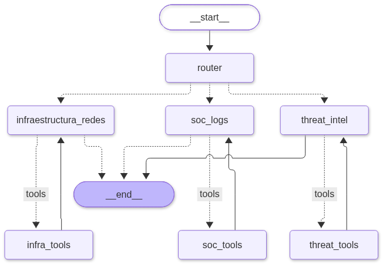

<div align="center">

# Capazeta agent

### Asistente ciberseguridad multi-agente modular basado en LangGraph y LangChain

[](https://www.python.org/)
[](LICENSE)
[]()
[](https://github.com/joaquincernik/inteligencia-artificial-final/actions/workflows/tests.yml)

</div>

---

## 📋 Tabla de contenidos

- [Demo](#-demo)
- [Sobre el proyecto](#-sobre-el-proyecto)
  - [Contexto académico](#contexto-académico)
  - [Construido con](#construido-con)
- [El dataset](#-el-dataset)
- [Metodología](#-metodología)
- [Resultados](#-resultados)
- [Estructura del proyecto](#-estructura-del-proyecto)
- [Instalación](#-instalación)
- [Integración con Wazuh (Docker)](#integración-con-wazuh-docker)
- [Uso](#-uso)
- [Tests](#-tests)
- [Roadmap](#-roadmap)
- [Autor](#-autor)
- [Licencia](#-licencia)
- [Agradecimientos y referencias](#-agradecimientos-y-referencias)

---

## 🎬 Demo



Capazeta se ejecuta de forma interactiva a través de una interfaz de línea de comandos (CLI) impulsada por `uv run capazeta`.

---

## 📖 Sobre el proyecto

**Capazeta** es un asistente de ciberseguridad multi-agente modular desarrollado con **LangGraph** y **LangChain**. Su propósito es ayudar a equipos de seguridad, administradores de red y analistas de SOC a realizar tareas de diagnóstico, análisis de vulnerabilidades, investigación de amenazas e interpretación de logs en tiempo real.

El sistema organiza sus capacidades en 3 nodos de subagentes especializados, coordinados por un enrutador principal:

1. **Infraestructura y Redes:** Análisis de topología de red, segmentación, firewalls y escaneo con Nmap.
2. **SOC / Logs y Eventos:** Análisis de SIEM, triaje de incidentes e integración con alertas de Wazuh.
3. **Threat Intelligence:** Mapeo de TTPs en MITRE ATT&CK mediante RAG (FAISS) e investigación de IOCs/CVEs.

Las verticales de **Aplicaciones Web y APIs**, **Mobile** y **OT/ICS** quedan fuera de esta iteración: están comentadas en el grafo a la espera de contar con herramientas propias.

### Contexto académico

- **Asignatura:** Inteligencia Artificial
- **Institución:** Instituto Universitario Aeronáutico
- **Cohorte / año:** 2026
- **Docente:** Alexis Gonzalez

### Construido con

- [Python 3.10+](https://www.python.org/)
- [LangChain](https://www.langchain.com/) / [LangGraph](https://python.langchain.com/docs/langgraph/)
- [FAISS](https://github.com/facebookresearch/faiss) — Almacenamiento vectorial para RAG
- [Wazuh API & Indexer](https://wazuh.com/) — Integración con SIEM y gestión de alertas
- [python-nmap](https://xael.org/pages/python-nmap-en.html) — Automatización de escaneos de red
- [Rich](https://rich.readthedocs.io/) — Interfaz de terminal (paneles, spinner y Markdown)
- [LangSmith](https://smith.langchain.com/) — Trazabilidad, monitoreo y evaluación de las ejecuciones
- [ReportLab](https://www.reportlab.com/) — Renderizado de reportes PDF
- [Docker](https://www.docker.com/) — Stack local de Wazuh (manager, indexer y dashboard)
- [uv](https://docs.astral.sh/uv/) — Gestión rápida de entornos y dependencias

---

## 📊 El dataset

Capazeta utiliza la base de conocimiento oficial **MITRE ATT&CK Enterprise** para alimentar su módulo RAG (*Retrieval-Augmented Generation*).

| Campo | Detalle |
|---|---|
| Fuente | [MITRE ATT&CK Enterprise STIX Bundle](https://github.com/mitre-attack/attack-stix-data) |
| Formato | JSON / STIX 2.1 |
| Vector Index | FAISS (Índice vectorial generado con embeddings de Gemini o Cloudflare Workers AI) |
| Variables / Campos | IDs de técnicas, tácticas, descripciones, mitigaciones y referencias de TTPs |
| Licencia del dataset | Apache 2.0 (MITRE ATT&CK) |

---

## 🔬 Metodología

### Arquitectura Multi-Agente

Capazeta implementa un grafo direccionado de estados (`StateGraph`) respaldado por persistencia en memoria (`InMemorySaver`):

- **Router Central:** Clasifica el requerimiento del usuario y delega la tarea al subagente de dominio correspondiente.
- **Herramientas (ToolNodes):** Subagentes con capacidad de ejecución de herramientas iterativas (`infraestructura_redes`, `soc_logs`, `threat_intel`), utilizando bucles de Tool Calling para invocar escaneos Nmap, consultas al Indexer/API de Wazuh y búsquedas vectoriales sobre MITRE ATT&CK.


### Definición PEAS del agente

Para formalizar el comportamiento del sistema, se define Capazeta bajo el marco PEAS (Russell & Norvig):

| Elemento | Definición | Aplicación en Capazeta |
| :-- | :-- | :-- |
| **P - *Performance Measure* (Medida de rendimiento)** | Criterios para evaluar si el agente actúa correctamente. | Enrutamiento correcto al subagente, mapeo preciso a técnicas/tácticas MITRE ATT&CK, respuestas fundamentadas en el contexto recuperado, minimización de alucinaciones y utilidad de los reportes generados. |
| **E - *Environment* (Entorno)** | Espacio con el que interactúa el agente. | Consultas del usuario, stack de Wazuh (API/Indexer), objetivo de red para escaneo con Nmap, base de conocimiento MITRE ATT&CK, sistema de archivos local y herramientas disponibles. |
| **A - *Actuators* (Actuadores)** | Acciones que puede ejecutar del agente. | Respuestas al usuario, llamadas a herramientas (`run_nmap_scan`, `wazuh_list_agents`, `wazuh_search_alerts`, `wazuh_mitre_coverage`, `search_mitre_attack`), razonamiento entre subagentes y generación/guardado de reportes en Markdown y PDF. |
| **S - *Sensors* (Sensores)** | Percepciones que recibe del agente. | Mensajes del usuario, resultados de las herramientas ejecutadas, información recuperada del índice FAISS de MITRE ATT&CK, alertas/eventos de Wazuh, resultados de escaneo Nmap y estado del grafo (`AgentState`). |

### Sistema RAG (MITRE ATT&CK)

Las consultas sobre inteligencias de amenazas y cobertura de eventos se resuelven mediante búsqueda semántica contra un índice vectorial FAISS (`data/mitre/faiss`). Las técnicas y tácticas se parsean y sincronizan localmente desde el bundle de STIX.

Por defecto se usan embeddings de Gemini (`models/gemini-embedding-001`). También se puede usar Cloudflare Workers AI: configurá `CLOUDFLARE_ACCOUNT_ID`, `CLOUDFLARE_API_TOKEN` y un `EMBEDDING_MODEL` con prefijo `@cf/` (por ejemplo `@cf/qwen/qwen3-embedding-0.6b`), y reconstruí el índice con `uv run python -m capazeta.rag.build`. El índice debe regenerarse porque cambia la dimensión de los vectores.

### Ground truth de la evaluación RAG

El conjunto de evaluación tiene **31 alertas de Wazuh** (descripciones de alerta) provenientes de **25 reglas únicas**; una misma regla puede aparecer en varias filas cuando Wazuh emite descripciones distintas (por ejemplo, la regla 80791 aparece con cuatro rutas borradas). La anotación completa está en [`tests/wazuh_ground_truth_annoted.csv`](tests/wazuh_ground_truth_annoted.csv) y el subconjunto que consume LangSmith, en [`tests/dataset_evaluacion_langsmith.csv`](tests/dataset_evaluacion_langsmith.csv). El procedimiento de clasificación y evaluación está implementado en [`notebooks/02_evaluacion_rag.ipynb`](notebooks/02_evaluacion_rag.ipynb).

- **Fuente de la técnica:** el `mitre_id` de referencia se tomó del **mapeo MITRE ATT&CK que declaran las propias reglas de Wazuh** (`rule.id` → `mitre.id`), no de una comparación manual contra el catálogo.
- **Unidad de anotación:** cada fila corresponde a una descripción de alerta (`rule.description`), que es exactamente el texto que se usa como consulta al retriever. La columna `Count` registra cuántos eventos de esa descripción se observaron y **no** se usa para ponderar la métrica.
- **Casos sin mapeo explícito:** cuando la regla no traía una técnica declarada, se infirió a partir del recurso auditado y de reglas relacionadas, y se marcó en `notes` como `Inferido`. Es el caso de la regla 80783 (`Audit: Watch - Read access.`), mapeada a T1003.008 por el watch de lectura sobre `/etc/shadow`.
- **Notas de anotación:** `notes` documenta ambigüedades y advertencias. Las cinco filas con nota son:

| Regla | Alerta | Nota textual |
| :--- | :--- | :--- |
| 80783 | Audit: Watch - Read access. | `Inferido: watch de lectura (audit-wazuh-r) sobre /etc/shadow` |
| 554 | File added to the system. | `Mapeo según Wazuh; tambien aplica T1565.001` |
| 80781 | Audit: Watch - Write access: /etc/passwd. | `Tambien podria ser T1098` |
| 521 | Possible kernel level rootkit | `Probable falso positivo en este entorno` |
| 5301 | User missed the password to change UID (user id). | `Fallo de su` |

- **Reglas con más de una técnica válida:** el dataset de evaluación guarda **una sola técnica de referencia por alerta** (el mapeo principal de Wazuh). Las alternativas quedan documentadas en `notes`, pero el evaluador actual (`mitre_retrieval_evaluator`, en los notebooks 02 y 03) solo compara contra ese `mitre_id` principal. Por lo tanto, si el retriever devuelve una alternativa válida en lugar de la principal, la fila se cuenta como *miss*. Es un criterio **conservador**: Hit@5 y MRR funcionan como piso, no como techo.

---

## 📈 Resultados

### Estado actual (MVP funcional)

El sistema se encuentra en etapa de **MVP funcional**. Se validó cualitativamente la correcta ejecución de las siguientes funcionalidades:

- **Enrutamiento multi-agente:** Clasificación correcta de las consultas hacia los 3 dominios de especialidad activos.
- **Herramientas activas:** Escaneo de red con Nmap (destino, puertos y flags validados contra una lista blanca), consulta de agentes/eventos/alertas desde Wazuh API/Indexer y generación automatizada de reportes en Markdown y PDF.
- **RAG MITRE ATT&CK:** Recuperación semántica de técnicas y tácticas desde el bundle STIX sobre un índice vectorial FAISS, con embeddings de Gemini (por defecto) o Cloudflare Workers AI.
- **Arquitectura modular:** Grafo LangGraph con bucles de tool-calling y persistencia en memoria (`InMemorySaver`).

### Evaluación cuantitativa del retrieval

Se evaluó el módulo de recuperación del RAG sobre **31 alertas reales de Wazuh** (25 reglas únicas) mapeadas a MITRE ATT&CK a partir de las propias reglas de Wazuh. El dataset de evaluación está en [`tests/dataset_evaluacion_langsmith.csv`](tests/dataset_evaluacion_langsmith.csv) y la anotación completa (con regla, técnica, táctica y notas) en [`tests/wazuh_ground_truth_annoted.csv`](tests/wazuh_ground_truth_annoted.csv). El criterio de anotación se detalla en [Ground truth de la evaluación RAG](#ground-truth-de-la-evaluación-rag).

Las métricas se registraron con **LangSmith**:

- **Hit@5:** proporción de consultas en las que la técnica de referencia (el `mitre_id` principal anotado) aparece entre los 5 primeros resultados. Las técnicas alternativas documentadas en `notes` no se acreditan.
- **MRR (*Mean Reciprocal Rank*):** promedio del inverso de la posición de la técnica de referencia en el ranking (0 si no aparece).
- **Latencia promedio:** tiempo medio de respuesta del retrieval por consulta.

| Modelo / Sistema | Tipo / Proveedor | Muestras | Hit@5 | IC 95 % (Hit@5) | MRR | Latencia prom. |
| :--- | :--- | :---: | :---: | :---: | :---: | :---: |
| **Gemini embedding-001** | Semántico / Google Cloud | 31 | **67.74 %** | **[51.29 %, 84.20 %]** | **0.4866** | 636.4 ms |
| **Qwen3 embedding-0.6b** | Semántico / Cloudflare Workers AI | 31 | **54.84 %** | [37.32 %, 72.36 %] | **0.3989** | 2012.0 ms |
| **BGE-Large-EN-v1.5** | Semántico / Cloudflare Workers AI | 31 | **51.61 %** | [34.02 %, 69.20 %] | **0.3505** | 651.7 ms |
| **Baseline (TF-IDF)** | Léxico tradicional / algorítmico | 31 | **32.26 %** | [15.80 %, 48.71 %] | **0.2769** | **6.8 ms** |


**Intervalos de confianza y alcance del experimento:** cada modelo se evaluó en **una sola corrida**, sin repeticiones. El dataset tiene **31 alertas que cubren 17 técnicas MITRE distintas** (25 reglas únicas), por lo que los números son frágiles. El IC del 95 % se calculó con la aproximación normal (Wald): `p ± 1.96·sqrt(p(1−p)/n)`, donde `p` es el Hit@5 observado y `n` la cantidad de alertas evaluadas (31, o 14 en Plamo). Por eso el IC de Gemini va de **51.29 % a 84.20 %** (redondeado, 52 %–84 %) y se superpone con los de Qwen3 y BGE: la ventaja observada es **indicativa**, no concluyente. **Ampliar el dataset es la mejora prioritaria**; con más alertas y más técnicas los intervalos se angostan y la comparación gana robustez.

**Lectura de los resultados:** el mejor modelo semántico (Gemini embedding-001) mejora el baseline léxico TF-IDF en **+35.48 puntos porcentuales de Hit@5** y casi duplica el MRR (0.4866 vs. 0.2769). El costo es la latencia: 636.4 ms frente a 6.8 ms del baseline. La diferencia contra TF-IDF es la más clara (los intervalos no se solapan), mientras que entre los modelos semánticos el orden debe tomarse como tendencia.

**Limitaciones de la anotación:** al ser un ground truth de etiqueta única, los valores de la tabla son conservadores. En las dos filas con técnica alternativa (554 → T1565.001; 80781 → T1098), las corridas registradas no devolvieron esas alternativas en el Top 5, así que los números no cambian; si en el futuro se aceptaran, el Hit@5 solo podría subir. Además, una de las 31 filas (80783) usa una técnica inferida: un cambio en esa anotación movería el Hit@5 como máximo 3.2 puntos porcentuales (1/31) y el MRR hasta 0.032, y el efecto exacto depende del modelo.

Los resultados completos, con el análisis por modelo, están en [`notebooks/02_evaluacion_rag.ipynb`](notebooks/02_evaluacion_rag.ipynb) y [`notebooks/03_evaluacion_modelos_embedding.ipynb`](notebooks/03_evaluacion_modelos_embedding.ipynb); las salidas crudas de LangSmith, en [`reports/`](reports/).

### Evaluación pendiente (generación LLM)

La calidad de la **respuesta final** todavía no está medida. Queda pendiente evaluar:

- **Fidelidad (*Faithfulness*):** que todas las afirmaciones y técnicas mencionadas estén respaldadas por el contexto recuperado.
- **Relevancia de la respuesta (*Answer Relevance*):** que la respuesta esté alineada con la consulta original.

Para automatizar estas métricas se planea usar [**Ragas**](https://docs.ragas.io/) integrado con [LangSmith](https://www.langchain.com/langsmith), tal como se detalla en el [roadmap](#-roadmap).


---

## 📂 Estructura del proyecto

```text
.
├── README.md
├── LICENSE
├── pyproject.toml
├── .gitignore
├── .env.example
├── src/
│   └── capazeta/
│       ├── config.py           # Configuración de variables de entorno y parámetros
│       ├── embeddings.py       # Configuración del modelo de Embeddings
│       ├── llm.py              # Inicialización y abstracción de Chat Models
│       ├── main.py             # Bucle de interacción interactivo (CLI)
│       ├── ui.py               # Capa de presentación de la CLI (Rich)
│       ├── graph/              # Grafo de estados, nodos y constructor de LangGraph
│       │   ├── builder.py
│       │   ├── nodes.py
│       │   └── state.py
│       ├── rag/                # Construcción y lectura de índice FAISS (MITRE)
│       │   ├── build.py
│       │   └── mitre.py
│       └── tools/              # Herramientas (Nmap, Wazuh, MITRE RAG, Reportes)
│           ├── mitre_tool.py
│           ├── nmap_tool.py
│           ├── pdf_report.py
│           ├── report.py
│           └── wazuh_tool.py
├── data/
│   └── mitre/                  # Datos y catálogo de técnicas de MITRE ATT&CK
├── reports/                    # CSVs de evaluación y reportes generados (.md/.pdf)
├── notebooks/                  # Notebooks de exploración, evaluación y demos
├── tests/                      # Tests de Nmap y PDFs, datasets de evaluación y script de Wazuh
├── infra/
│   └── wazuh/                  # Stack Docker single-node de Wazuh
└── docs/
    ├── index.html              # Página estática para GitHub Pages
    ├── assets/
    │   ├── input.css           # Fuente de Tailwind (tokens y componentes)
    │   ├── tailwind.css        # CSS compilado y versionado
    │   └── app.js              # Tema claro/oscuro, scroll-spy y animaciones
    └── img/                    # Diagrama de arquitectura y capturas
        ├── grafico.png
        ├── cli.png
        └── comparativa_embeddings.png
```

El sitio de `docs/` es estático y no necesita build para publicarse en GitHub Pages: el CSS compilado (`docs/assets/tailwind.css`) queda versionado. Si modificás el HTML, regenerá los estilos con:

```bash
npm install
npm run build:css
```

---

## ⚙️ Instalación

### Prerrequisitos

- [uv](https://docs.astral.sh/uv/getting-started/installation/)
- Git
- Python >= 3.10
- [Docker](https://www.docker.com/) y [Docker Compose](https://docs.docker.com/compose/) *(solo si vas a utilizar la integración con Wazuh)*

### Pasos

```bash
# 1. Cloná el repositorio
git clone https://github.com/joaquincernik/inteligencia-artificial-final

# 2. Creá el entorno virtual e instalá las dependencias con uv
uv venv --python 3.10
source .venv/bin/activate  # En Windows: .venv\Scripts\activate

# 3. Sincronizá e instalá el proyecto en modo editable
uv sync
uv pip install -e .
```

### Configuración de Variables de Entorno

Copiá el archivo de ejemplo y completá con tus credenciales:

```bash
cp .env.example .env
```

Las variables principales son (el listado completo y comentado está en [`.env.example`](.env.example)):

```env
GOOGLE_API_KEY=tu_api_key_aqui
OPENAI_API_KEY=tu_openai_api_key_aqui
GROQ_API_KEY=tu_groq_api_key_aqui

# Cloudflare Workers AI (para embeddings alternativos)
CLOUDFLARE_ACCOUNT_ID=tu_account_id_aqui
CLOUDFLARE_API_TOKEN=tu_api_token_aqui

# Catálogo de modelos disponibles (elegí el activo en MODEL_NAME):
MODEL_1=google_genai:gemini-3.1-flash-lite
MODEL_2=groq:openai/gpt-oss-120b
#MODEL_3=openai:gpt-4o-mini
MODEL_4=groq:openai/gpt-oss-20b
MODEL_5=groq:qwen/qwen3.8-27b
MODEL_6=groq:openai/gpt-oss-safeguard-20b

# Modelo activo (referenciá una variable definida arriba):
MODEL_NAME=${MODEL_2}

# Configuración MITRE RAG
EMBEDDING_MODEL=models/gemini-embedding-001
MITRE_STIX_URL=https://raw.githubusercontent.com/mitre-attack/attack-stix-data/master/enterprise-attack/enterprise-attack.json
MITRE_DATA_DIR=data/mitre

# Configuración Wazuh
WAZUH_API_URL=https://localhost:55000
WAZUH_API_USER=wazuh-wui
WAZUH_API_PASSWORD=tu_password_aqui
WAZUH_INDEXER_URL=https://localhost:9200
WAZUH_INDEXER_USER=admin
WAZUH_INDEXER_PASSWORD=tu_password_aqui
WAZUH_VERIFY_SSL=false

# LangSmith (trazabilidad)
LANGSMITH_TRACING=true
LANGSMITH_ENDPOINT=https://api.smith.langchain.com
LANGSMITH_API_KEY=tu_langsmith_api_key_aqui
LANGSMITH_PROJECT=IA
``` 

### Trazabilidad con LangSmith

Capazeta puede enviar cada ejecución del grafo a [LangSmith](https://smith.langchain.com/) para inspeccionar el recorrido del router, las llamadas a tools (Nmap, Wazuh, RAG MITRE) y el consumo de tokens.

1. Creá una cuenta en [smith.langchain.com](https://smith.langchain.com/) y generá una API key (`Settings → API Keys`).
2. Completá las variables en tu `.env`:

```env
LANGSMITH_TRACING=true
LANGSMITH_ENDPOINT=https://api.smith.langchain.com
LANGSMITH_API_KEY=tu_langsmith_api_key_aqui
LANGSMITH_PROJECT=IA
```

3. Ejecutá `uv run capazeta` como siempre. Las trazas aparecen en el proyecto **IA**.

En el dashboard, cada consulta se registra como un run llamado `capazeta`, etiquetado con `model:<id>` (por ejemplo `model:gpt-oss-120b`) y con la metadata `model` y `thread_id`, lo que permite filtrar las ejecuciones por modelo o por sesión.

Para desactivar el tracing alcanza con `LANGSMITH_TRACING=false`; no hay que tocar código.

---

## Integración con Wazuh (Docker)

Capazeta cuenta con herramientas para consultar agentes, alertas y realizar mapeo a MITRE ATT&CK utilizando un stack de Wazuh. Para levantarlo localmente podés utilizar la configuración incluida en `infra/wazuh/`.

### Requisitos
- Docker y Docker Compose
- Mínimo 4GB de RAM libres (recomendado)
- Sistema Linux, macOS o Windows con WSL2

### Pasos para levantar el stack

```bash
# 1. Ir al directorio de Wazuh (single-node)
cd infra/wazuh

# 2. Aumentar vm.max_map_count (obligatorio en Linux)
sudo sysctl -w vm.max_map_count=262144

# 3. Generar los certificados TLS (solo la primera vez)
docker compose -f generate-indexer-certs.yml run --rm generator

# 4. Levantar el stack en segundo plano
docker compose up -d
```

### Acceso

| Servicio | URL / Puerto | Credenciales por defecto |
| :-- | :-- | :-- |
| Wazuh Dashboard | `https://localhost` | Configuradas en el stack (revisar `docker-compose.yml` / `config/`) |
| Wazuh API | `https://localhost:55000` | Coinciden con las variables `WAZUH_API_*` |
| Wazuh Indexer (OpenSearch) | `https://localhost:9200` | Coinciden con las variables `WAZUH_INDEXER_*` |

> **Nota:** El stack utiliza certificados auto-firmados. Por ese motivo es importante mantener `WAZUH_VERIFY_SSL=false` en el `.env` de Capazeta para pruebas locales. 

Para detener el entorno: `docker compose down`. Para detenerlo y eliminar volúmenes (borrando datos): `docker compose down -v`.

---

## ▶️ Uso

Para iniciar el asistente interactivo Capazeta desde la terminal:

```bash
uv run capazeta
```

O alternativamente ejecutando el módulo principal:

```bash
uv run python -m capazeta.main
```

Para actualizar o reconstruir el índice RAG de MITRE ATT&CK:

```bash
uv run python -m capazeta.rag.build --force
```


Para actualizar o reconstruir el índice RAG de MITRE ATT&CK sin descargar nuevamente:

```bash
uv run python -m capazeta.rag.build --force --no-download
```
### Interfaz de terminal

La CLI está construida con [Rich](https://rich.readthedocs.io/): al iniciar muestra un banner con el modelo y el `thread_id` en uso, un spinner mientras el grafo procesa la consulta, la respuesta del subagente renderizada como Markdown dentro de un panel, y una línea final con los tokens de entrada, salida, total de la interacción y acumulado de la sesión.

```
╭──────────────────────────────── 🛡️  Capazeta ────────────────────────────────╮
│  modelo  google_genai:gemini-2.5-flash-lite                                  │
│  thread  capazeta_thread                                                     │
│  salir   salir · Ctrl+C · Ctrl+D                                             │
╰────────────────── asistente multi-agente de ciberseguridad ──────────────────╯

vos ❯ ¿qué técnicas MITRE usa un login fallido repetido?

╭────────────────────────── Threat Intelligence ───────────────────────────────╮
│  La técnica asociada es **T1110 - Brute Force** ...                          │
╰──────────────────────────────────────────────────────────────────────────────╯
──────────────────────────────────────────────────────────────────────────
entrada 1.200  salida 350  total 1.550  sesión 4.200
```

Para salir: `salir`, `exit`, `quit` o `Ctrl+C` / `Ctrl+D`.

### Reportes PDF

Las herramientas que generan reportes aceptan `save_pdf=True` además de `save_md=True`. El PDF se renderiza desde el mismo Markdown con [ReportLab](https://www.reportlab.com/) (`src/capazeta/tools/pdf_report.py`): hoja A4, tablas con encabezado, tipografía DejaVu (acentos y símbolos) y pie de página con fecha y número de página. Si se piden ambos formatos, se generan el `.md` y el `.pdf` en la misma llamada.

```text
vos ❯ escaneá 192.168.0.0/24 y guardá el reporte en PDF

La tool devuelve, entre otros campos:
{
  "target": "192.168.0.0/24",
  "results": [...],
  "pdf_file": "reports/nmap_192.168.0.0_24_20261106-120000.pdf"
}
```

Herramientas con soporte PDF: `run_nmap_scan`, `wazuh_search_alerts`, `wazuh_mitre_coverage` y `search_mitre_attack`. Los reportes `.md` y `.pdf` generados se guardan en `reports/` y están ignorados por git (`.gitignore`); los CSV de evaluación que ya están en esa carpeta sí se versionan.

---

## 🧪 Tests

Los tests cubren los dos puntos críticos de las herramientas: la **allowlist de Nmap** (que un prompt malicioso no pueda colar `--script`, flags de escritura o inyecciones de shell) y la **generación de reportes PDF** con ReportLab.

```bash
uv sync --group dev
uv run pytest
```

En GitHub Actions, el workflow [`tests.yml`](.github/workflows/tests.yml) corre automáticamente la suite rápida (`uv run pytest -m "not network"`) en cada push a `master`, en las ramas `features/**` y en los Pull Requests. El test de red no se ejecuta en CI: se corre solo en local cuando le pasás `--nmap-target`.

Son 15 funciones de test rápidas (50 casos con parametrización) repartidas por tema: **10 de Nmap en [`tests/test_nmap.py`](tests/test_nmap.py)** y **5 de PDFs en [`tests/test_pdf.py`](tests/test_pdf.py)**. Corren en menos de un segundo y no necesitan red, credenciales ni el binario de `nmap`: la validación se prueba sobre funciones puras y el escaneo se simula con un `PortScanner` falso. Los PDFs se escriben en directorios temporales, así que no ensucian `reports/`.

Los casos maliciosos incluyen `--script vuln`, `--script=http-shellshock`, `-sV; rm -rf /`, `$(whoami)`, backticks, `-oN`/`-oX` (escritura de archivos), `-iL` (lista de hosts), `-p` (puertos fuera del parámetro validado), `-D`/`-S`/`-e` (spoofing) y targets/puertos fuera de rango.

### Test de integración contra una red real

Además del suite rápido hay **un test opt-in** (en `tests/test_nmap.py`, marker `network`) que ejecuta Nmap de verdad. Se omite si no le pasás una red:

```bash
# Suite rápida: el test de red se omite
uv run pytest

# Todos los tests de Nmap (los rápidos + el de red)
uv run pytest tests/test_nmap.py --nmap-target 192.168.0.0/24 -s

# Solo el test de red
uv run pytest -m network --nmap-target 192.168.0.0/24 -s

# Con otros flags permitidos y un rango de puertos
uv run pytest -m network --nmap-target 192.168.0.0/24 --nmap-arguments="-sT -F --open" --nmap-ports="22,80,443" -s

# Equivalente con variable de entorno
CAPAZETA_NMAP_TARGET=192.168.0.0/24 uv run pytest -m network -s
```

El target se valida con `_validate_target` y los flags con la misma allowlist que usa el agente, así que `--nmap-arguments="--script vuln"` se rechaza igual que desde la CLI. El test no genera reportes (`save_md`/`save_pdf` quedan en `False`). Si la red bloquea ICMP y `-sn` no encuentra hosts, probá con `--nmap-arguments="-sT -F --open"`.

> Cuando el valor de `--nmap-arguments` empieza con `-`, usá la forma con `=` (`--nmap-arguments="-sT -F --open"`). Si lo pasás separado por un espacio, pytest interpreta `-sT` como la opción `-s` y falla con `argument -s: ignored explicit argument`.

---

## 🗺️ Roadmap

### Completado
- [x] **Evaluación cuantitativa de Retrieval:** métricas *Hit@5* y *MRR* sobre 31 alertas de Wazuh anotadas con técnicas MITRE ATT&CK. Ver [Resultados](#-resultados).
- [x] **Baseline comparativo léxico:** implementación y evaluación de TF-IDF contra los modelos de embeddings (32.26 % de Hit@5 vs. 67.74 % del mejor modelo semántico).
- [x] **Exportación de reportes a PDF:** implementada con `save_pdf=True` en `run_nmap_scan`, `wazuh_search_alerts`, `wazuh_mitre_coverage` y `search_mitre_attack`. El Markdown de `report.py` se renderiza a PDF con ReportLab en `src/capazeta/tools/pdf_report.py`.
- [x] **Tests automáticos:** suite de `pytest` en [`tests/test_nmap.py`](tests/test_nmap.py) y [`tests/test_pdf.py`](tests/test_pdf.py) sobre la allowlist de Nmap (scripts, inyecciones, flags peligrosos) y la generación de PDFs. Ver [Tests](#-tests).

### Mejoras propuestas para futuros proyectos
- [ ] **Ampliación del dataset de evaluación:** sumar más alertas de Wazuh y cubrir más técnicas MITRE (hoy son 31 alertas y 17 técnicas distintas). Con un dataset ampliado se repetirá la comparación entre modelos y se recalcularán los intervalos de confianza del 95 % para reducir la fragilidad de los resultados.
- [ ] **Ground truth multi-etiqueta:** registrar todas las técnicas MITRE válidas por alerta y adaptar `mitre_retrieval_evaluator` para aceptar cualquiera de ellas; hoy las alternativas están en `notes` pero no se acreditan.
- [ ] **Evaluación de generación LLM:** medición de *Fidelidad (Faithfulness)* y *Relevancia de la Respuesta (Answer Relevance)* utilizando [Ragas](https://docs.ragas.io/) integrado con [LangSmith](https://www.langchain.com/langsmith).
- [ ] **Contrastación con otras verticales de ciberseguridad:** integración y mapeo a marcos complementarios como **MITRE D3FEND** (contramedidas defensivas), **ATT&CK for Cloud**, **ATT&CK for Mobile** y **ATT&CK for ICS**, permitiendo contrastar hallazgos entre diferentes dominios y enriquecer el razonamiento del agente.
- [ ] **Persistencia de conversaciones:** incorporación de persistencia de hilos con base de datos (PostgreSQL / SQLite Checkpointer).
- [ ] **Ampliación de herramientas:** reactivar las verticales `web_apis`, `mobile` y `ot_ics` (hoy comentadas en el grafo) una vez que cuenten con herramientas propias.
- [ ] **Interfaz amigable:** migrar la interacción de la terminal a una interfaz web o más amigable para el usuario, por ejemplo con herramientas como Streamlit, Chainlit o Gradio.

Todo esto excede el alcance del trabajo final estipulado
---

## 👥 Autor

- **Joaquin Cernik** — [GitHub](https://github.com/joaquincernik) · [LinkedIn](https://linkedin.com/in/joaquincernik)

---

## 📄 Licencia

Este proyecto está bajo la licencia [MIT](LICENSE) — ver el archivo `LICENSE` para más detalle.

---

## 🙏 Agradecimientos y referencias

- Frameworks **LangChain** y **LangGraph** por la infraestructura de orquestación multi-agente.
- **MITRE ATT&CK®** por la matriz pública de conocimiento de técnicas y tácticas de ciberseguridad.
- Proyecto **Wazuh** por la plataforma Open Source de SIEM y XDR.
