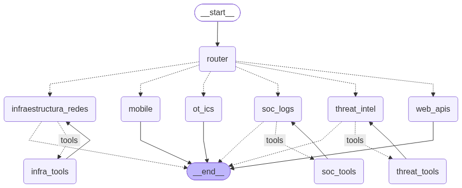

<div align="center">

# Capazeta agent

### Asistente ciberseguridad multi-agente modular basado en LangGraph y LangChain

[](https://www.python.org/)
[](LICENSE)
[]()

</div>

---

## 📋 Tabla de contenidos

- [Demo](#-demo)
- [Sobre el proyecto](#-sobre-el-proyecto)
  - [Contexto académico](#contexto-académico)
  - [Construido con](#construido-con)
- [El dataset](#-el-dataset)
- [Metodología](#-metodología)
- [Resultados](#-resultados)
- [Estructura del proyecto](#-estructura-del-proyecto)
- [Instalación](#-instalación)
- [Uso](#-uso)
- [Roadmap](#-roadmap)
- [Autores](#-autores)
- [Licencia](#-licencia)
- [Agradecimientos y referencias](#-agradecimientos-y-referencias)

---

## 🎬 Demo



Capazeta se ejecuta de forma interactiva a través de una interfaz de línea de comandos (CLI) impulsada por `uv run capazeta`.

---

## 📖 Sobre el proyecto

**Capazeta** es un asistente cibernético multi-agente modular desarrollado con **LangGraph** y **LangChain**. Su propósito es ayudar a equipos de seguridad, administradores de red y analistas de SOC a realizar tareas de diagnóstico, análisis de vulnerabilidades, investigación de amenazas e interpretación de logs en tiempo real.

El sistema organiza sus capacidades en 6 nodos de subagentes especializados, coordinados por un enrutador principal:

1. **Infraestructura y Redes:** Análisis de topología de red, segmentación, firewalls y escaneo con Nmap.
2. **Aplicaciones Web y APIs:** Seguridad en aplicaciones web, OWASP Top 10, autenticación y hardening de APIs.
3. **Mobile:** Seguridad en plataformas Android/iOS, análisis de APKs/IPAs, almacenamiento local y comunicaciones.
4. **SOC / Logs y Eventos:** Análisis de SIEM, triaje de incidentes e integración con alertas de Wazuh.
5. **Threat Intelligence:** Mapeo de TTPs en MITRE ATT&CK mediante RAG (FAISS) e investigación de IOCs/CVEs.
6. **OT / ICS:** Protocolos de control industrial (Modbus, DNP3, S7), modelo Purdue y seguridad operacional.

### Contexto académico

- **Asignatura:** [Nombre de la materia]
- **Institución:** [Nombre de la institución]
- **Cohorte / año:** [Año]
- **Docente:** [Nombre del/la docente]

### Construido con

- [Python 3.10+](https://www.python.org/)
- [LangChain](https://www.langchain.com/) / [LangGraph](https://python.langchain.com/docs/langgraph/)
- [FAISS](https://github.com/facebookresearch/faiss) — Almacenamiento vectorial para RAG
- [Wazuh API & Indexer](https://wazuh.com/) — Integración con SIEM y gestión de alertas
- [python-nmap](https://xael.org/pages/python-nmap-en.html) — Automatización de escaneos de red
- [uv](https://docs.astral.sh/uv/) — Gestión rápida de entornos y dependencias

---

## 📊 El dataset

Capazeta utiliza la base de conocimiento oficial **MITRE ATT&CK Enterprise** para alimentar su módulo RAG (*Retrieval-Augmented Generation*).

| Campo | Detalle |
|---|---|
| Fuente | [MITRE ATT&CK Enterprise STIX Bundle](https://github.com/mitre-attack/attack-stix-data) |
| Formato | JSON / STIX 2.1 |
| Vector Index | FAISS (Índice vectorial generado con embeddings de Gemini) |
| Variables / Campos | IDs de técnicas, tácticas, descripciones, mitigaciones y referencias de TTPs |
| Licencia del dataset | Apache 2.0 (MITRE ATT&CK) |

---

## 🔬 Metodología

### Arquitectura Multi-Agente

Capazeta implementa un grafo direccionado de estados (`StateGraph`) respaldado por persitencia en memoria (`InMemorySaver`):

- **Router Central:** Clasifica el requerimiento del usuario y delega la tarea al subagente de dominio correspondiente.
- **Herramientas (ToolNodes):** Subagentes con capacidad de ejecución de herramientas iterativas (`infraestructura_redes`, `soc_logs`, `threat_intel`), utilizando bucles de Tool Calling para invocar escaneos Nmap, consultas al Indexer/API de Wazuh y búsquedas vectoriales sobre MITRE ATT&CK.


### Sistema RAG (MITRE ATT&CK)

Las consultas sobre inteligencias de amenazas y cobertura de eventos se resuelven mediante búsqueda semántica contra un índice vectorial FAISS (`data/mitre/faiss`). Las técnicas y tácticas se parsean y sincronizan localmente desde el bundle de STIX.

---

## 📈 Resultados

[pendiente de completar una vez evaluado formalmente el rendimiento del sistema]

Actualmente, el sistema ejecuta de forma funcional la clasificación de dominios, ejecuciones de herramientas Nmap/Wazuh y consultas semánticas RAG sobre la base de datos de MITRE ATT&CK.

---

## 📂 Estructura del proyecto

```text
.
├── README.md
├── pyproject.toml
├── .gitignore
├── src/
│   └── capazeta/
│       ├── config.py           # Configuración de variables de entorno y parámetros
│       ├── embeddings.py       # Configuración del modelo de Embeddings
│       ├── llm.py              # Inicialización y abstracción de Chat Models
│       ├── main.py             # Bucle de interacción interactivo (CLI)
│       ├── graph/              # Grafo de estados, nodos y constructor de LangGraph
│       │   ├── builder.py
│       │   ├── nodes.py
│       │   └── state.py
│       ├── rag/                # Construcción y lectura de índice FAISS (MITRE)
│       │   ├── build.py
│       │   └── mitre.py
│       └── tools/              # Herramientas (Nmap, Wazuh, MITRE RAG, Reportes)
│           ├── firewall_tool.py
│           ├── mitre_tool.py
│           ├── nmap_tool.py
│           ├── report.py
│           └── wazuh_tool.py
├── data/
│   └── mitre/                  # Datos y catálogo de técnicas de MITRE ATT&CK
├── reports/                    # Salida de reportes generados (.md)
├── notebooks/                  # Notebooks de exploración y pruebas
├── tests/                      # Suite de pruebas unitarias/integración
└── docs/
    ├── index.html              # Página estática para GitHub Pages
    └── img/
        └── grafico.png         # Diagrama del grafo de agentes
```

---

## ⚙️ Instalación

### Prerrequisitos

- [uv](https://docs.astral.sh/uv/getting-started/installation/)
- Git
- Python >= 3.10

### Pasos

```bash
# 1. Cloná el repositorio
git clone https://github.com/TU-USUARIO/capazeta.git
cd capazeta

# 2. Creá el entorno virtual e instalá las dependencias con uv
uv venv --python 3.10
source .venv/bin/activate  # En Windows: .venv\Scripts\activate

# 3. Sincronizá e instalá el proyecto en modo editable
uv sync
uv pip install -e .
```

### Configuración de Variables de Entorno

Creá un archivo `.env` en la raíz del proyecto basándote en el siguiente formato:

```env
GOOGLE_API_KEY=tu_api_key_aqui
MODEL_NAME=google_genai:gemini-2.5-flash-lite

# Configuración Opcional Wazuh
WAZUH_API_URL=https://localhost:55000
WAZUH_API_USER=admin
WAZUH_API_PASSWORD=admin_password
WAZUH_INDEXER_URL=https://localhost:9200
WAZUH_INDEXER_USER=admin
WAZUH_INDEXER_PASSWORD=indexer_password
WAZUH_VERIFY_SSL=false
```

---

## ▶️ Uso

Para iniciar el asistente interactivo Capazeta desde la terminal:

```bash
uv run capazeta
```

O alternativamente ejecutando el módulo principal:

```bash
uv run python -m capazeta.main
```

Para actualizar o reconstruir el índice RAG de MITRE ATT&CK:

```bash
uv run python -m capazeta.rag.build --force
```

---

## 🗺️ Roadmap

- [ ] Incorporación de persistencia de hilos con base de datos (PostgreSQL / SQLite Checkpointer).
- [ ] Ampliación de herramientas de escaneo web para el agente `web_apis`.
- [ ] Evaluación cuantitativa de precisión en el enrutamiento de subagentes.

---

## 👥 Autor

- **Joaquin Cernik** — [GitHub](https://github.com/joaquincernik) · [LinkedIn](https://linkedin.com/in/joaquincernik)

---

## 📄 Licencia

Este proyecto está bajo la licencia [MIT](LICENSE) — ver el archivo `LICENSE` para más detalle.

---

## 🙏 Agradecimientos y referencias

- Frameworks **LangChain** y **LangGraph** por la infraestructura de orquestación multi-agente.
- **MITRE ATT&CK®** por la matriz pública de conocimiento de técnicas y tácticas de ciberseguridad.
- Proyecto **Wazuh** por la plataforma Open Source de SIEM y XDR.
